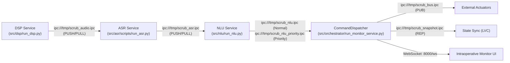

# Assemble V1: Architecture & Integration Quick Reference

> **Project:** Scrub-Voice — Offline Edge Intraoperative Surgical Voice Assistant  
> **Target Deployment Device:** Raspberry Pi 4 Model B (Quad-core ARM Cortex-A72 @ 1.5 GHz, 4GB RAM, aarch64 OS)  
> **Active Milestone Branch:** `Assemble_V1`

---

## 1. High-Level Outcome Summary

| Metric | Target Budget | Measured on Pi 4 | Status | Deep-Dive Reference |
| :--- | :--- | :--- | :--- | :--- |
| **Total Post-Speech Latency** | $\le 500\text{ ms}$ | **$293.85\text{ ms}$** | **PASS** | [`evaluations/full-pipe/`](../evaluations/full-pipe/README.md) |
| **DSP Real-Time Factor (RTF)** | $\le 0.50$ | **0.4490** ($2.2\times$ faster than real-time) | **PASS** | [`evaluations/dsp/`](../evaluations/dsp/README.md) |
| **ASR Grammar Decoding Latency**| $\le 200\text{ ms}$ | **$119 - 140\text{ ms}$** | **PASS** | [`evaluations/asr/`](../evaluations/asr/README.md) |
| **NLU Intent Latency (2 Thr)** | $\le 200\text{ ms}$ | **$152.85\text{ ms}$** | **PASS** | [`evaluations/nlu/`](../evaluations/nlu/README.md) |
| **ZeroMQ IPC Transit Latency** | $\le 5.0\text{ ms}$ | **$2.68\text{ ms}$** | **PASS** | [`evaluations/orchestrator/`](../evaluations/orchestrator/README.md) |
| **Supervisor Chaos Recovery** | $\le 500\text{ ms}$ | **$358.2\text{ ms}$** | **PASS** | [`evaluations/orchestrator/`](../evaluations/orchestrator/README.md) |
| **Total Resident RAM (RSS)** | $\le 1000\text{ MB}$ | **$635.5\text{ MB}$** ($> 3.3\text{ GB}$ free) | **PASS** | [`evaluations/full-pipe/`](../evaluations/full-pipe/README.md) |
| **Draft 2020-12 Schema Validity** | $100\%$ | **100.0%** (85/85 valid) | **PASS** | [`evaluations/nlu/`](../evaluations/nlu/README.md) |
| **Out-of-Domain (OOD) Rejection** | $\ge 90\%$ | **100.0%** (15/15 rejected) | **PASS** | [`evaluations/nlu/`](../evaluations/nlu/README.md) |

---

## 2. IPC Sockets & Communication Architecture



### IPC Socket Directory
* `ipc:///tmp/scrub_audio.ipc`: DSP $\rightarrow$ ASR (PCM 16kHz audio chunks + `{"type": "end"}` control signals).
* `ipc:///tmp/scrub_asr.ipc`: ASR $\rightarrow$ NLU (Transcribed text, word-level confidence, timestamps).
* `ipc:///tmp/scrub_nlu.ipc`: NLU $\rightarrow$ Dispatcher (Normal priority validated command envelopes).
* `ipc:///tmp/scrub_nlu_priority.ipc`: NLU $\rightarrow$ Dispatcher (Emergency fast-path envelopes, e.g. `STOP`, `FREEZE`).
* `ipc:///tmp/scrub_bus.ipc`: Dispatcher $\rightarrow$ External consumers (ZeroMQ PUB bus).
* `ipc:///tmp/scrub_snapshot.ipc`: State sync server (ZeroMQ REP for Last-Value-Cache queries).

---

## 3. Subsystem File & Change Lookup

| Subsystem | Primary Implementation Files | Metrics & Evals | What Changed from Prototype |
| :--- | :--- | :--- | :--- |
| **DSP** | [`src/dsp/run_dsp.py`](file:///mnt/p/AntiGravity/FinalYear/Project_CurrentTopic/scrub-voice/src/dsp/run_dsp.py)<br/>[`src/dsp/source/audio_streamer.py`](file:///mnt/p/AntiGravity/FinalYear/Project_CurrentTopic/scrub-voice/src/dsp/source/audio_streamer.py)<br/>[`src/dsp/source/vad.py`](file:///mnt/p/AntiGravity/FinalYear/Project_CurrentTopic/scrub-voice/src/dsp/source/vad.py) | [DSP Metrics](../evaluations/dsp/README.md) | [DSP Changes](../evaluations/dsp/CHANGES.md) |
| **ASR** | [`src/asr/scripts/run_asr.py`](file:///mnt/p/AntiGravity/FinalYear/Project_CurrentTopic/scrub-voice/src/asr/scripts/run_asr.py)<br/>[`src/asr/vocab.py`](file:///mnt/p/AntiGravity/FinalYear/Project_CurrentTopic/scrub-voice/src/asr/vocab.py) | [ASR Metrics](../evaluations/asr/README.md) | [ASR Changes](../evaluations/asr/CHANGES.md) |
| **NLU** | [`src/nlu/pipeline.py`](file:///mnt/p/AntiGravity/FinalYear/Project_CurrentTopic/scrub-voice/src/nlu/pipeline.py)<br/>[`src/nlu/run_nlu.py`](file:///mnt/p/AntiGravity/FinalYear/Project_CurrentTopic/scrub-voice/src/nlu/run_nlu.py)<br/>[`src/nlu/slot_extractor.py`](file:///mnt/p/AntiGravity/FinalYear/Project_CurrentTopic/scrub-voice/src/nlu/slot_extractor.py)<br/>[`src/nlu/normalizer.py`](file:///mnt/p/AntiGravity/FinalYear/Project_CurrentTopic/scrub-voice/src/nlu/normalizer.py) | [NLU Metrics](../evaluations/nlu/README.md) | [NLU Changes](../evaluations/nlu/CHANGES.md) |
| **Orchestrator** | [`src/orchestrator/run_monitor_service.py`](file:///mnt/p/AntiGravity/FinalYear/Project_CurrentTopic/scrub-voice/src/orchestrator/run_monitor_service.py)<br/>[`src/orchestrator/supervisor.py`](file:///mnt/p/AntiGravity/FinalYear/Project_CurrentTopic/scrub-voice/src/orchestrator/supervisor.py) | [Orchestrator Metrics](../evaluations/orchestrator/README.md) | [Orchestrator Changes](../evaluations/orchestrator/CHANGES.md) |
| **Full Pipeline** | [`test/benchmark_edge_profile.py`](file:///mnt/p/AntiGravity/FinalYear/Project_CurrentTopic/scrub-voice/test/benchmark_edge_profile.py)<br/>[`pyproject.toml`](file:///mnt/p/AntiGravity/FinalYear/Project_CurrentTopic/scrub-voice/pyproject.toml) | [Full Pipeline Metrics](../evaluations/full-pipe/README.md) | [Full Pipeline Changes](../evaluations/full-pipe/CHANGES.md) |

---

## 4. Operational CLI Commands Quick Reference

### Launch Full Live Pipeline (Hardware ReSpeaker Array)
```bash
uv run python src/orchestrator/supervisor.py
```

### Launch Offline Simulation Stream (Single-Pass WAV + Audio Dumper)
```bash
uv run python src/orchestrator/supervisor.py \
  --wav data/asr/test_mix_voice.wav \
  --single-pass \
  --dump-audio results/dsp_debug
```

### Run Edge Profiler (2 PyTorch/ONNX Threads)
```bash
uv run python test/benchmark_edge_profile.py --threads 2
```

### Launch Intraoperative Browser Monitor
Open `http://localhost:8000` (or `http://<PI_IP>:8000`) in any modern web browser.
