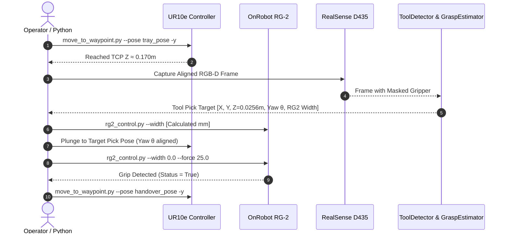

# Universal Robots (UR10e) & OnRobot RG-2 Control Guide

This guide documents the CLI commands, parameters, and safety protocols for controlling and testing the **Universal Robots UR10e** arm and the **OnRobot RG-2 parallel-jaw gripper** across the physical hardware, URSim virtual controller, and MuJoCo physics simulation.

---

## 1. Quick Reference Cheat Sheet

| Task                                         | Target Backend         | Command                                                                                   |
| :------------------------------------------- | :--------------------- | :---------------------------------------------------------------------------------------- |
| **Verify UR10e Connectivity & Motion** | Real Robot / URSim     | `python3 src/actuators/sim_ws/hello_ur.py 192.168.1.105`                                |
| **Verify UR10e Motion in Sim**         | MuJoCo Physics (GUI)   | `python3 src/actuators/sim_ws/hello_ur.py --sim`                                        |
| **Verify UR10e Motion Headless**       | MuJoCo (CI / Headless) | `python3 src/actuators/sim_ws/hello_ur.py --sim --headless`                             |
| **Move UR10e to Tray Scan Pose**       | Real Robot / URSim     | `python3 src/actuators/sim_ws/move_to_waypoint.py --pose tray_pose -y`                  |
| **Move UR10e to Home (Parking)**       | Real Robot / URSim     | `python3 src/actuators/sim_ws/move_to_waypoint.py --pose home_pose -y`                  |
| **Move UR10e to Handover Zone**        | Real Robot / URSim     | `python3 src/actuators/sim_ws/move_to_waypoint.py --pose handover_pose -y`              |
| **Move UR10e to Tray in Sim**          | MuJoCo Physics         | `python3 src/actuators/sim_ws/move_to_waypoint.py --sim --pose tray_pose -y`            |
| **UR10e Offset Plunge (Fine-tune)**    | Real Robot / URSim     | `python3 src/actuators/sim_ws/move_to_waypoint.py --pose tray_pose --offset-z -0.05 -y` |
| **Run RG-2 Gripper Test Cycle**        | Real Hardware          | `python3 src/actuators/sim_ws/rg2_control.py 192.168.1.101 --test`                      |
| **Run RG-2 Gripper Test in Sim**       | MuJoCo Physics (GUI)   | `python3 src/actuators/sim_ws/rg2_control.py --sim --test`                              |
| **Run RG-2 Test Headless**             | MuJoCo (CI / Headless) | `python3 src/actuators/sim_ws/rg2_control.py --sim --headless --test`                   |
| **Set RG-2 Gripper Width**             | Real Hardware          | `python3 src/actuators/sim_ws/rg2_control.py --width 45.0 --force 20.0`                 |
| **Query RG-2 Gripper Status**          | Real Hardware          | `python3 src/actuators/sim_ws/rg2_control.py --status`                                  |

---

## 2. Pre-requisites & Network Setup

Both the robot arm and the gripper communicate over the local Ethernet subnet (`192.168.1.0/24`):

```text
Host PC (WSL2 / Linux): 192.168.1.20
├── UR10e Controller:    192.168.1.105 (Dashboard 29999, RTDE 30004)
└── OnRobot Compute Box: 192.168.1.101 (Modbus TCP 502, Slave ID 65)
```

Ensure your network interface is brought up:

```bash
sudo ip link set eth0 up
sudo ip addr replace 192.168.1.20/24 dev eth0

# Verify connectivity to robot dashboard and gripper
nc -zv -w 2 192.168.1.105 29999   # UR10e Dashboard
nc -zv -w 2 192.168.1.101 502     # OnRobot RG-2 Modbus
```

---

## 3. `hello_ur.py` — Robot Arm Healthcheck & Diagnostic

`src/actuators/sim_ws/hello_ur.py` is the primary arm verification tool. It automatically:

1. Connects to Dashboard Server (port 29999), powers ON motors, and releases brakes if stopped.
2. Connects to RTDE (port 30004) and queries actual joint angles and TCP Cartesian coordinates.
3. Executes a safe verification trajectory: **Home Pose $\rightarrow$ Sterile Handover Zone $\rightarrow$ Home Pose**.

### Usage on Physical UR10e / URSim

```bash
# Auto-detect IP (or defaults to 127.0.0.1)
python3 src/actuators/sim_ws/hello_ur.py

# Specify explicit robot IP
python3 src/actuators/sim_ws/hello_ur.py 192.168.1.105

# Or via environment variable
export ROBOT_IP=192.168.1.105
python3 src/actuators/sim_ws/hello_ur.py
```

### Usage on MuJoCo Physics Simulation

```bash
# Interactive 3D viewer
python3 src/actuators/sim_ws/hello_ur.py --sim

# Headless mode (no display window, useful for SSH / automated testing)
python3 src/actuators/sim_ws/hello_ur.py --sim --headless
```

---

## 4. `move_to_waypoint.py` — Waypoint Navigation

`src/actuators/sim_ws/move_to_waypoint.py` reads calibrated target poses from [`src/actuators/waypoints.json`](file:///home/emberfox205/ur_arm/src/actuators/waypoints.json) and commands smooth, collision-free joint trajectories (`moveJ`).

### Available Waypoints

| Waypoint Name                         | TCP Height ($Z$)            | Description & Use Case                                                                                                                                                              |
| :------------------------------------ | :---------------------------- | :---------------------------------------------------------------------------------------------------------------------------------------------------------------------------------- |
| **`tray_pose`** *(Default)* | $Z \approx 0.170\text{ m}$  | **Camera Standoff Scan Pose.** Wrist camera looks straight down at the surgical tray with calibrated optical offset ($\Delta X=-43.1\text{ mm}, \Delta Y=+15.3\text{ mm}$). |
| **`tray_contact_pose`**       | $Z \approx 0.0256\text{ m}$ | **Physical Table Pick Pose.** RG-2 gripper fingers touch the table floor ($\Delta Z = -144.8\text{ mm}$ plunge from `tray_pose`).                                         |
| **`home_pose`**               | $Z \approx 0.439\text{ m}$  | **Safe Parking Pose.** Upright neutral pose with Joint 5 bent at $-90^\circ$ to prevent wrist singularities.                                                                |
| **`handover_pose`**           | $Z \approx 0.137\text{ m}$  | **Sterile Handover Zone.** Presents grasped instruments forward toward the surgeon's palm.                                                                                    |
| **`camera_start_pose`**       | $Z \approx 0.574\text{ m}$  | **High Vantage Pose.** Overview perspective across the entire operating workspace.                                                                                            |

---

### Command Examples

#### Move to Tray Scan Pose (Preparation for Camera Capture)

```bash
python3 src/actuators/sim_ws/move_to_waypoint.py --pose tray_pose -y
```

#### Return to Safe Home (Parking)

```bash
python3 src/actuators/sim_ws/move_to_waypoint.py --pose home_pose -y
```

#### Present Tool to Handover Zone

```bash
python3 src/actuators/sim_ws/move_to_waypoint.py --pose handover_pose -y
```

#### Adjust Motion Speed and Acceleration

```bash
# Slow, cautious motion (0.15 rad/s)
python3 src/actuators/sim_ws/move_to_waypoint.py --pose tray_pose --speed 0.15 --accel 0.2 -y

# Normal operational motion (0.5 rad/s)
python3 src/actuators/sim_ws/move_to_waypoint.py --pose tray_pose --speed 0.5 --accel 0.6 -y
```

#### Cartesian Fine-Tuning Offsets (`--offset-x`, `--offset-y`, `--offset-z`)

Applies linear Cartesian offsets on top of any recorded waypoint using `poseTrans` + `moveL`:

```bash
# Move to tray_pose, then plunge 5 cm down in Z (-0.05 m)
python3 src/actuators/sim_ws/move_to_waypoint.py --pose tray_pose --offset-z -0.05 -y

# Combined 3D offset plunge
python3 src/actuators/sim_ws/move_to_waypoint.py --pose tray_pose --offset-x 0.02 --offset-y -0.01 --offset-z -0.10 -y
```

#### Run in MuJoCo Physics Simulation

```bash
# Move simulated UR10e to tray pose in 3D viewer
python3 src/actuators/sim_ws/move_to_waypoint.py --sim --pose tray_pose -y

# Headless simulation test
python3 src/actuators/sim_ws/move_to_waypoint.py --sim --headless --pose home_pose -y
```

---

## 5. `rg2_control.py` — OnRobot RG-2 Gripper Control

`src/actuators/sim_ws/rg2_control.py` communicates directly with the **OnRobot Compute Box via Modbus TCP** (port 502, slave unit ID 65). It has **zero third-party dependencies** (implemented using standard Python `socket` and `struct`), and shares a seamless interface with the MuJoCo simulation adapter.

### Hardware Specifications

* **Stroke Width:** $0.0\text{ mm}$ (fully closed) to $110.0\text{ mm}$ (fully open).
* **Clamping Force:** $3.0\text{ N}$ to $40.0\text{ N}$ (default: $20.0\text{ N}$).

---

### Command Examples

#### 1. Automated Verification Test Cycle (`--test`)

Executes a 3-step opening, clamping, and neutral centering sequence:

* **Step 1:** Open to $60.0\text{ mm}$ (force limit $20\text{ N}$)
* **Step 2:** Close to $20.0\text{ mm}$ (force limit $15\text{ N}$)
* **Step 3:** Reopen to neutral standby $50.0\text{ mm}$

```bash
# On physical hardware (Compute Box at 192.168.1.101)
python3 src/actuators/sim_ws/rg2_control.py 192.168.1.101 --test

# In MuJoCo physics simulation (3D GUI)
python3 src/actuators/sim_ws/rg2_control.py --sim --test

# In MuJoCo physics simulation (Headless / CI)
python3 src/actuators/sim_ws/rg2_control.py --sim --headless --test
```

#### 2. Direct Width & Force Command (`--width`, `--force`)

Commands the fingers to pre-open to an exact millimeter opening width calculated by the vision pipeline:

```bash
# Pre-open to 45.0 mm with 20 N force limit
python3 src/actuators/sim_ws/rg2_control.py 192.168.1.101 --width 45.0 --force 20.0

# Fully open gripper (110 mm)
python3 src/actuators/sim_ws/rg2_control.py 192.168.1.101 --width 110.0

# Fully close gripper (0 mm)
python3 src/actuators/sim_ws/rg2_control.py 192.168.1.101 --width 0.0 --force 30.0

# In MuJoCo simulation
python3 src/actuators/sim_ws/rg2_control.py --sim --width 55.0
```

#### 3. Query Gripper Status & Sensor Feedback (`--status`)

Reads Holding Registers 267 and 268 to inspect live finger position, grip detection, and safety circuit state:

```bash
python3 src/actuators/sim_ws/rg2_control.py 192.168.1.101 --status
```

**Example Output:**

```text
RG-2 Status: Width = 45.2 mm | Busy = False | Grip = True
```

---

## 6. Full End-to-End Workflow (Tray Scan $\rightarrow$ Grasp)



---

## 7. Safety Protocols

> [!IMPORTANT]
> 1. **Emergency Stop (E-Stop):** Always keep the physical teach pendant E-Stop button within reach during live motions.
> 2. **Wrist Singularity Protection:** Joint 5 (Wrist 2) is maintained near $-90^\circ$ ($-1.57\text{ rad}$) across all recorded waypoints. Do not manually rotate Joint 5 to $0^\circ$ or $180^\circ$ (aligned with the forearm), as this causes kinematic singularities and erratic controller faults.
> 3. **Table Clearance Bounds:** Never command pick plunge depths below $Z = 0.020\text{ m}$ relative to base space, as this risks driving the gripper fingers into the physical table surface.
> 4. **Finger Jamming Protection:** The OnRobot RG-2 automatically triggers its safety circuit if external resistance stops finger motion unexpectedly. Query status with `--status` to verify `safety_circuit_active: False` before commanding new widths.

---

## 8. Actuator Service Daemon & Persistent Connectivity (`run_actuator_service.py`)

The `ActuatorService` (`src/actuators/service.py`, `src/actuators/run_actuator_service.py`) provides a persistent, daemonized execution engine for incoming voice commands:

- **Single Persistent Connection:** Connects to the UR10e RTDE interface and OnRobot RG-2 Modbus bus **once** on service startup. Subsequent voice commands (`pick_tool`, `park_arm`) execute with **< 2 ms latency**, eliminating the 1.5–3.0 s reconnection overhead of one-off CLI invocations.
- **ZeroMQ Command Bus Ingestion:** Subscribes to the central Orchestrator bus (`ipc:///tmp/scrub_bus.ipc`) on the `TOOL_HANDLING` topic.
- **State Machine Safety Gating:**
  - `IDLE`: Connected at home pose, ready to accept commands.
  - `BUSY`: Actively executing a motion (drops or queues overlapping motion commands).
  - `FAULT`: Entered if vision miss or grip unconfirmed occurs. While in `FAULT`, new `pick_tool` commands are safely rejected.
- **Fault Recovery via `park_arm`:** If the system enters `FAULT`, the operator or supervisor issues a `park_arm` command. The arm safely navigates back to `home_pose`, closes gripper fingers, clears `last_error`, and restores state to `IDLE`.

### Running Standalone

```bash
# In MuJoCo simulation (headless)
python src/actuators/run_actuator_service.py --sim --headless

# With real UR10e and RG-2 hardware
python src/actuators/run_actuator_service.py --robot-ip 192.168.1.105 --gripper-ip 192.168.1.101
```

### Running with Supervisor

The multi-process supervisor auto-spawns and monitors `ACTUATOR` when `--sim` or `--enable-actuators` is supplied:

```bash
python -m src.orchestrator.supervisor --sim
```

---

## 9. Operator Control & Mode Switching via `test_monitor_prompt.py`

The test prompt console (`test/test_monitor_prompt.py`) provides operators with structured command dispatch and operational mode control:

- **Operational Modes:**
  - `TOOL_HANDLING` *(Active)*: Automated tray retrieval, affordance grasp estimation, sterile handover.
  - `CAMERA_LIGHT` *(Deferred)*: Endoscope / surgical lighting manipulation and jogging.
- **CLI Mode Argument:** Specify mode directly on the CLI:
  ```bash
  python test/test_monitor_prompt.py --mode TOOL_HANDLING --pick-tool scalpel
  ```
- **Interactive Mode Switching:** In the interactive console (`python test/test_monitor_prompt.py`), option `[M]` toggles between `TOOL_HANDLING` and `CAMERA_LIGHT`. Mode switching enforces an empty gripper safety interlock (arm must be parked before switching).

