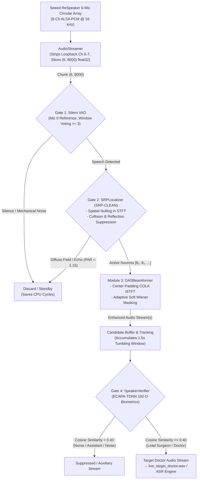

# Digital Signal Processing (DSP) & Target Speaker Extraction (TSE) Module

This module implements the real-time edge acoustic front-end for `scrub-voice`. It is designed for multi-channel circular microphone arrays operating in noisy, reverberant clinical environments (such as operating rooms with surgical suction pumps, laminar-flow ventilation, and patient vitals monitors).

The pipeline ingests raw multi-channel audio from hardware, filters acoustic artifacts, identifies human speech activity, calculates 2D sound source Direction of Arrival (DoA) using **pure frequency-domain SRP-CLEAN spatial deflation**, steers constructive beams with **multi-beam Soft Wiener post-filtering**, and enforces **ECAPA-TDNN biometric speaker verification** to isolate the Lead Surgeon's voice from circulating nurses and auxiliary staff.

---

## 1. Architecture & Pipeline Overview

The front-end is organized as a 4-Gate cascading pipeline optimized for real-time execution on resource-constrained edge hardware (Raspberry Pi 4, Quad-Core ARM Cortex-A72):



---

## 2. Core Submodules

### 2.1. Shared Configuration (`source/circuit_framing_config.py`)
Encapsulates physical array geometry and STFT framing parameters into shared, reusable contracts to guarantee SOLID design:
* **`CircularMicrophoneArray`:**
  * Radius: $r = 0.04625\text{ m}$ ($46.25\text{ mm}$).
  * Microphones: 6 circular capsules at angles `[300°, 240°, 180°, 120°, 60°, 0°]`.
  * Precomputes 3D steering phase tensors: `(360, num_mics, num_freqs)`.
* **`AudioFramingConfig`:**
  * Sample rate: $16,000\text{ Hz}$.
  * Frame size: $512$ samples ($32\text{ ms}$).
  * Hop size: $256$ samples ($16\text{ ms}$, 50% overlap).

---

### 2.2. Audio Streamer (`source/audio_streamer.py`)
Handles low-latency, hardware-buffered audio capture directly from ALSA or offline WAV replay:
* **Target Hardware:** Seeed ReSpeaker 6-Mic Circular Array (`plughw:seeed8micvoicec,0`).
* **Channel Demuxing:** Captures 8 interleaved hardware channels, drops channels 6 and 7 (hardware AEC loopback), and emits the 6 microphone channels.
* **Buffer Stability:** Configured with `--buffer-time=500000` (500 ms ALSA driver buffer) to eliminate driver overruns (XRUNs).
* **Data Contract:** Emits normalized float32 chunks of shape `(6, 8000)` in range `[-1.0, 1.0]`.
* **Simulation Mode:** Pass `wav_path="path/to/test.wav"` for hardware-free development and offline CI benchmarking.

---

### 2.3. Voice Activity Detection — Gate 1 (`source/vad.py`)
Acts as the first filter to prevent unnecessary spatial and neural computation during silent periods:
* **Model:** Deep-learning based Silero VAD neural network (`snakers4/silero-vad:master`).
* **Offline-First Loading:** Automatically loads from local cache (`~/.cache/torch/hub/snakers4_silero-vad_master`) using `source='local'`, preventing network latency and HTTP 504 timeouts on the Pi.
* **Phase Preservation:** Uses **Mic 0 (`audio_chunk[0]`)** as the single reference channel. This eliminates destructive multi-mic phase cancellation that occurs when averaging across circular arrays.
* **Inference Logic:** Evaluates 512-sample sub-windows. A chunk is classified as active speech if $\ge 3$ sub-windows exceed the speech threshold ($0.50$).

---

### 2.4. Sound Source Localizer — Gate 2 (`source/localizer.py`)
Computes 2D azimuth Direction of Arrival (DoA) using **pure frequency-domain SRP-CLEAN (Steered Response Power with Spatial Deflation)**:
* **Frequency Range:** Bounded to `100 Hz - 3500 Hz` by default. Bounding below the spatial aliasing limit ($f_{\text{alias}} \approx 3700\text{ Hz}$) of the $46.25\text{ mm}$ circular array suppresses spatial grating lobes.
* **Spatial Deflation Loop (Pure SRP-CLEAN):**
  Instead of zero-masking angular power (which creates artificial cliff-edge discontinuities), SRP-CLEAN subtracts the beamformed signal in the STFT complex domain:
  $$Y_{\text{dom}}(t, f) = \frac{1}{M} \sum_{m=1}^M X_m(t, f) \cdot e^{j \phi_m(\theta_{\text{dom}}, f)}$$
  $$X_m(t, f) \leftarrow X_m(t, f) - Y_{\text{dom}}(t, f) \cdot e^{-j \phi_m(\theta_{\text{dom}}, f)}$$
* **Triple-Defense Halting Criteria:**
  1. **Spatial Flatness (PAR):** Stops if $\text{PAR} = \frac{\max(P)}{\text{mean}(P)} < 1.15$ (diffuse room noise / flat residual field).
  2. **Collision Check:** Halts if the candidate peak falls within $\pm 15^\circ$ of an already detected speaker.
  3. **Room Echo & Reflection Rejection:** Halts if the candidate peak's power in the un-deflated initial field is below threshold (`pass1_power[dom_idx] < 0.35`) or if residual power falls below relative floor (`max_p < 0.25 * pass1_max`). This prevents microscopic wall reflections from being magnified into false secondary talkers.

---

### 2.5. Delay-and-Sum Beamformer with Soft Wiener Masking (`source/beamformer.py`)
Extracts clean, separated directional audio streams for all active speakers simultaneously:
* **Center-Padding COLA Synthesis:**
  Symmetrically pads input chunks with reflection (`pad_left = 256`, `pad_right = 448`). The original 8000 samples fall entirely within the flat Constant Overlap-Add (COLA) zone ($\sum w^2(n) = 1.0$), completely eliminating boundary clicks and 4ms silence gaps across consecutive chunks.
* **Multi-Beam Soft Wiener Masking:**
  When multiple competing talkers are active ($K > 1$), computes continuous time-frequency Wiener gain masks:
  $$W_k(f, t) = \text{clip}\left(\frac{P_k(f, t)}{P_k(f, t) + \alpha_{\text{eff}} \cdot \sum_{j \ne k} P_j(f, t) + \epsilon}, 0.10, 1.0\right)$$
  where $\alpha_{\text{eff}} = \frac{\alpha}{\max(1, K-1)}$ dynamically scales with speaker count. Suppresses cross-talk by $> 20\text{ dB}$ with zero musical noise.

---

### 2.6. Speaker Verification & Biometrics — Gate 4 (`source/speaker_verifier.py`)
Provides the final biometric gate to enforce Target Speaker Extraction (TSE):
* **Model:** Pretrained ECAPA-TDNN ONNX model (`models/ecapa_tdnn/voxceleb_ECAPA512.onnx`, ~24 MB).
* **Embedding:** Extracts a 192-dimensional L2-normalized biometric speaker embedding from 80-bin Log-Mel filterbanks.
* **Decision Rule:** Computes Cosine Similarity against the enrolled Lead Surgeon embedding:
  $$\text{Score} = \mathbf{e}_{\text{candidate}} \cdot \mathbf{e}_{\text{doctor}} \ge \tau$$
  In the real-time streaming pipeline (`run_pipeline.py`), $\tau = 0.40$ (optimized for 1.5s tumbling candidate windows; standalone default is $0.65$). Scores $\ge \tau$ route the audio to the doctor stream, while auxiliary staff and background voices are suppressed.

---

### 2.7. Lead Surgeon Voice Enrollment (`source/enroll_doctor.py`)
* **Zero-Restart Live Enrollment:** Enrolls the doctor on the active audio stream upon pipeline boot if `doctor_profile.npy` is missing.
* **VAD-Supervised Ingestion:** Collects $3.5\text{ seconds}$ of active speech chunks verified by VAD, extracts the 192-D profile, and persists it to disk.

---

### 2.8. Live Execution Pipeline (`source/run_pipeline.py`)
The primary production runner on Raspberry Pi 4:
* **Pre-Flight Memory Warm-Up:** Initializes all 4 stages in RAM before opening the ALSA stream to guarantee zero startup latency spikes.
* **Active Speaker Tracking:** Tracks speaker azimuths across frames with a configurable memory hangover (`MAX_TTL_FRAMES = 2` to `5`).
* **Real-Time Performance:** Average frame processing latency is **$180 - 320\text{ ms}$** on Raspberry Pi 4 (well within the $500\text{ ms}$ real-time budget, $\text{RTF} \approx 0.4$).
* **Safe Shutdown (`Ctrl+C`):** Automatically saves synchronized recordings to `data/dsp/output/`:
  * `live_raw.wav`: Multi-speaker raw microphone reference.
  * `live_target_doctor.wav`: Isolated, verified Lead Surgeon command audio.

---

## 3. Directory Layout

```text
src/dsp/
├── models/
│   └── ecapa_tdnn/
│       ├── voxceleb_ECAPA512.onnx    # ECAPA-TDNN ONNX neural network weights (~24 MB)
│       └── doctor_profile.npy        # 192-D biometric voiceprint of the Lead Surgeon
├── source/
│   ├── __init__.py
│   ├── audio_streamer.py             # ALSA hardware capture & buffer stripping
│   ├── circuit_framing_config.py     # Shared geometric array & STFT framing contracts
│   ├── vad.py                        # Gate 1: Silero VAD speech activity detection
│   ├── localizer.py                  # Gate 2: SRP-CLEAN spatial deflation localizer
│   ├── beamformer.py                 # Module 3: DAS beamformer with Soft Wiener & Center-COLA
│   ├── speaker_verifier.py           # Gate 4: ECAPA-TDNN ONNX speaker verification
│   ├── enroll_doctor.py              # Zero-restart live doctor voice enrollment
│   └── run_pipeline.py               # Real-time multi-gate live execution pipeline
└── test/
    ├── __init__.py
    ├── unittest_AudioStreamer.py     # Unit tests for hardware buffer slicing
    ├── unittest_localizer_level1.py  # 17 unit tests for SRP geometry, synthetic DoA & 3 sources
    ├── unittest_localizer_level2.py  # Visual diagnostic dashboard (Cartesian + Polar plots)
    ├── unittest_beamformer.py        # Unit tests for DAS steering, Wiener mask & COLA slicing
    ├── unittest_speaker_verifier.py  # Unit tests & latency benchmarks for ECAPA-TDNN
    ├── unittest_enroll_doctor.py     # Tests for profile loading, saving & duration checks
    └── test_phat_vs_clean.py         # Comparative benchmark between classic SRP-PHAT and SRP-CLEAN
```

---

## 4. Verification & Testing

The test suite runs entirely without hardware dependencies using synthetic far-field acoustic wave simulation:

```bash
# Run the complete DSP unit test suite (34/34 passing)
pytest src/dsp/test/unittest_localizer_level1.py src/dsp/test/unittest_beamformer.py src/dsp/test/unittest_AudioStreamer.py -v

# Run Level 2 visual diagnostic dashboard (saves plot to data/dsp/output/srp_diagnostic_dashboard.png)
python3 src/dsp/test/unittest_localizer_level2.py

# Test ECAPA-TDNN speaker verification
pytest src/dsp/test/unittest_speaker_verifier.py -v
```

---

## 5. Running on Raspberry Pi 4

1. **Calibrate Microphone Gain (AlsaMixer):**
   ```bash
   alsamixer
   # Press F6 -> Select 'seeed-8mic-voicecard'
   # Set capture levels to 40% - 50% to prevent digital clipping (Peak < 20,000)
   sudo alsactl store && sudo alsactl store -f /etc/voicecard/ac108_6mic.state
   ```

2. **Execute Live Pipeline:**
   ```bash
   python3 src/dsp/source/run_pipeline.py
   ```
   * *If no profile exists:* Speak for 3.5 seconds to enroll your voice.
   * *During operation:* The terminal outputs live real-time telemetry (peak volume meter, detected angles, beam streams, doctor verification score, and latency).
   * *Exit:* Press `Ctrl+C` to cleanly exit and save output WAV files.
