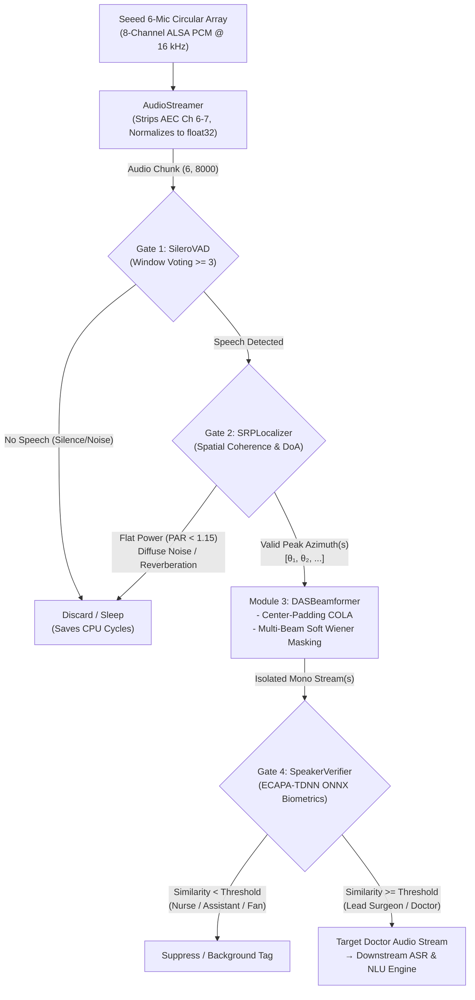

# Digital Signal Processing (DSP) Module

This module implements the edge acoustic front-end for `scrub-voice`. It is designed for multi-channel circular microphone arrays operating in noisy, reverberant clinical environments (such as operating rooms with surgical suction, ventilation, and patient monitors).

The pipeline ingests raw multi-channel audio from hardware, filters acoustic artifacts, identifies human speech activity, calculates sound source direction of arrival (DoA), and isolates target speakers using spatial beamforming with **multi-beam Soft Wiener post-filtering**, delivering clean isolated single-channel audio streams directly to downstream Automatic Speech Recognition (ASR) and Natural Language Understanding (NLU).

---

## 1. Architecture & Pipeline Overview

The front-end is organized as a phased gating and processing pipeline to minimize computational load on edge hardware (e.g., Raspberry Pi 4):



---

## 2. Core Submodules

### 2.1. Audio Streamer (`source/audio_streamer.py`)

Handles low-latency, uninterrupted streaming from the microphone hardware via standard ALSA subprocesses.

* **Target Hardware:** Seeed ReSpeaker 6-Mic Circular Array for Raspberry Pi (via `plughw:seeed8micvoicec,0`).
* **Hardware Channel Mapping:**
  * Physical capture delivers 8 interleaved channels: channels `0` to `5` correspond to circular microphones 1–6; channels `6` and `7` carry hardware Acoustic Echo Cancellation (AEC) playback loopback data.
  * `AudioStreamer` strips channels 6 and 7, retaining only the 6 circular microphone sensors.
* **Buffer Management:**
  * Uses `arecord` with `--buffer-time=500000` (500 ms ALSA driver buffer) to prevent buffer underruns (XRUNs) under heavy Raspberry Pi CPU loads.
  * Chunks are emitted in configurable durations (default `0.5 s` = 8,000 samples at 16 kHz).
* **Data Contract:**
  * Output shape: `(6, 8000)` (`(num_mics, num_samples)`).
  * Data type: `float32`, normalized from 16-bit signed PCM to `[-1.0, 1.0]`.
* **Graceful Lifecycle Management:**
  * Supports Python context manager (`with AudioStreamer() as streamer:`).
  * Shutdown closes the stdout pipe and issues a `SIGINT` signal to `arecord`, allowing the ALSA kernel driver to close cleanly without driver lockups or device-busy deadlocks.

---

### 2.2. Voice Activity Detection — Gate 1 (`source/vad.py`)

Acts as the first computational gate, determining whether an incoming multi-channel audio buffer contains active human speech before activating downstream spatial algorithms.

* **Model:** Pretrained Silero VAD neural network (`snakers4/silero-vad`).
* **Multichannel Reduction:**
  * Averages acoustic energy across all active microphones (`np.mean(audio_chunk, axis=0)`) to yield a high-SNR composite reference signal.
* **Inference & Window Voting:**
  * Evaluates audio in non-overlapping sub-windows of 512 samples (~32 ms at 16 kHz).
  * Uses **Window Voting (`speech_windows >= 3`)**: Requires at least 3 active sub-windows (~100 ms) within a 0.5s chunk to flag active speech, filtering transient mechanical clicks and wind puffs.
  * Preserves RNN recurrent hidden states across chunk boundaries to ensure seamless phonetic transitions without mid-sentence audio fragmentation.
  * If no speech is present, downstream localization, beamforming, and speaker verification are skipped entirely, saving edge processor cycles.

---

### 2.3. Sound Source Localizer — Gate 2 (`source/localizer.py`)

Calculates 2D azimuth Direction of Arrival (DoA) using Steered Response Power with Phase Transform (SRP-PHAT) and validates spatial coherence.

* **Array Geometry:**
  * Circular planar array with radius $r = 0.04625$ m (46.25 mm).
  * 6 microphones configured at angles: `[300°, 240°, 180°, 120°, 60°, 0°]`.
* **Precomputed Spatial Steering:**
  * Discrete azimuth grid with 1° resolution covering 360° (`[0°, 1°, ..., 359°]`).
  * Relative theoretical delay for azimuth $\theta$ and microphone $m$:
    $$\tau(\theta, m) = \frac{r}{c} \cos(\theta - \phi_m)$$
    where $c = 343.0\text{ m/s}$.
  * Precomputes full steering phase tensor of shape `(360, num_mics, num_freqs)`.
* **Frequency Band Selection:**
  * Evaluates Short-Time Fourier Transform (STFT) frames (frame size 512, hop size 256, Hann window).
  * Bounded to the human speech band (`100 Hz` to `3500 Hz`), filtering out high-frequency surgical tool hiss and electrical low-frequency hum.
* **Spatial Coherence Gating (Gate 2 Check):**
  * Computes steered power across all 360 directions and evaluates the Peak-to-Average Ratio:
    $$\text{PAR} = \frac{\max(P_{360})}{\text{mean}(P_{360}) + \epsilon}$$
  * If $\text{PAR} < \text{par\_threshold}$ (default `1.15`), the sound field lacks directional coherence (characteristic of diffuse room noise, air conditioning, or late reverberation). The gate closes and returns an empty angle list `[]`.
* **Multi-Speaker Peak Detection:**
  * Applies 30° circular padding to prevent detection dropouts at the $0^\circ / 360^\circ$ boundary.
  * Detects peaks using `scipy.signal.find_peaks` with minimum angular distance (15°), peak prominence (0.15), and minimum relative height (0.25).
  * Returns deduplicated list of speaker angles (e.g., `[60.0, 180.0]`) and the normalized spatial power curve.

---

### 2.4. Delay-and-Sum Beamformer with Multi-Beam Soft Wiener Masking (`source/beamformer.py`)

Steers focused constructive acoustic beams toward target speakers and isolates competing sound sources using Time-Frequency spatial post-filtering.

* **Steering & Reconstruction:**
  * Operates across the full frequency spectrum (0 Hz to Nyquist 8000 Hz, 257 bins for 512-point FFT).
  * Precomputed steering weights tensor with $\frac{1}{M}$ normalization:
    $$W_m(f, \theta) = \frac{1}{M} \exp\left(j 2 \pi f \cdot \frac{r}{c} \cos(\theta - \phi_m)\right)$$
  * Multi-target support: Steers multiple beams simultaneously across target angles using vectorized tensor operations.
* **Multi-Beam Soft Wiener Post-Filtering (`apply_wiener_mask=True`):**
  * When multiple speakers are present (e.g., Lead Surgeon at 60° and Scrub Nurse at 180°), Delay-and-Sum beamforming alone leaves residual cross-talk. To eliminate competing talkers without introducing the harsh musical noise of binary masks, the beamformer applies a continuous **Soft Wiener Gain Mask**:
    1. Computes instantaneous spectrogram power for each beam across all time-frequency bins:
       $$P_k(f, t) = |Y_k(f, t)|^2, \quad k \in \{1, \dots, K\}$$
    2. Sums total power across all active beams: $P_{\text{total}}(f, t) = \sum_{j=1}^K P_j(f, t)$.
    3. Calculates the competing interference power for target $k$:
       $$P_{\text{interf}, k}(f, t) = P_{\text{total}}(f, t) - P_k(f, t) = \sum_{j \ne k} P_j(f, t)$$
    4. Computes the smooth Wiener ratio with over-subtraction factor $\alpha$ (default `1.3`) and safety floor (default `0.10`, limiting max attenuation to $-20\text{ dB}$ to preserve acoustic naturalness):
       $$W_k(f, t) = \text{clip}\left(\frac{P_k(f, t)}{P_k(f, t) + \alpha \cdot P_{\text{interf}, k}(f, t) + \epsilon}, \text{floor}, 1.0\right)$$
    5. Directly scales the complex STFT coefficients in-place ($Y_k \leftarrow Y_k \cdot W_k$), achieving $>20\text{ dB}$ cross-talk suppression while maintaining smooth phase transitions.
* **Center-Padding COLA Synthesis (Click & Gap Elimination):**
  * Symmetrically pads boundaries (`pad_left = 256`, `pad_right = 448`, reflection mode) before STFT analysis.
  * Reconstructs via inverse STFT (`irfft`) and Hann window Overlap-Add (OLA). The original 8000 samples fall entirely within the flat Constant Overlap-Add (COLA) zone ($\sum w^2(n) = 1.0$).
  * Slices `[pad_left : pad_left + num_samples]`, completely eliminating the 4ms silence hole and boundary clicks across consecutive 0.5s streaming chunks.
* **Data Contract:**
  * Input: `audio_chunk` of shape `(6, N)`, `target_angles` (scalar `float` or `List[float]`).
  * Output: Single 1D array `(N,)` (if single angle) or `List[np.ndarray]` each of shape `(N,)` (if list of angles).

---

### 2.5. Speaker Verification & Biometrics — Gate 4 (`source/speaker_verifier.py`)

Performs Target Speaker Extraction (TSE) using a lightweight ONNX Runtime execution of ECAPA-TDNN (Emphasized Channel Attention, Propagation and Aggregation in TDNN).

* **Model & Quantization:**
  * Checkpoint: `src/dsp/models/ecapa_tdnn/voxceleb_ECAPA512.onnx` (~24 MB, trained on VoxCeleb).
  * Executes via `onnxruntime` with intra-op threading tuned for ARM Cortex-A72 cores.
  * Average inference latency on CPU: $\approx 35\text{ ms} - 45\text{ ms}$.
* **Feature Extraction:**
  * Converts 16 kHz mono beamformed audio into 80-bin Log-Mel Filterbank energies (`kaldi.fbank`, 25 ms frame length, 10 ms frame shift, Hamming window).
  * Applies utterance-level Cepstral Mean Normalization (CMVN).
* **Embedding & Voice Biometrics:**
  * Outputs an L2-normalized 192-dimensional speaker embedding vector $\mathbf{e} \in \mathbb{R}^{192}$ ($\|\mathbf{e}\|_2 = 1.0$).
  * Verifies incoming audio against the enrolled Lead Surgeon / Doctor reference embedding using Cosine Similarity:
    $$\text{Similarity}(\mathbf{e}_{\text{cand}}, \mathbf{e}_{\text{doc}}) = \mathbf{e}_{\text{cand}} \cdot \mathbf{e}_{\text{doc}} \in [-1.0, 1.0]$$
  * Rejects candidate beams below `similarity_threshold` (default `0.65`), filtering out auxiliary staff chatter, circulating nurses, and background acoustic noise before reaching the clinical ASR engine.

---

## 3. Module File Structure

```text
src/dsp/
├── __init__.py
├── denoise/                       # Standalone DeepFilterNet models & ONNX exports (excluded from this guide)
├── models/
│   └── ecapa_tdnn/
│       └── voxceleb_ECAPA512.onnx # Pretrained ECAPA-TDNN ONNX voice biometrics (~24 MB)
├── source/
│   ├── __init__.py
│   ├── audio_streamer.py          # ALSA arecord hardware capture & buffer stripping
│   ├── vad.py                     # Gate 1: Silero VAD speech activity detection (Window Voting)
│   ├── localizer.py               # Gate 2: SRP-PHAT DoA localization & PAR gating
│   ├── beamformer.py              # Module 3: Delay-and-Sum beamformer with Soft Wiener & Center-COLA
│   └── speaker_verifier.py        # Gate 4: ECAPA-TDNN ONNX speaker verification engine
└── test/
    ├── __init__.py
    ├── unittest_AudioStreamer.py      # Unit tests for hardware streaming buffer slicing
    ├── unittest_VAD.py                # Unit tests for Silero VAD gating & sensitivity
    ├── unittest_localizer_level1.py   # Unit tests for SRP-PHAT geometry & synthetic DoA
    ├── unittest_localizer_level2.py   # Boundary wrap-around & multi-speaker peak tests
    ├── unittest_beamformer.py         # Unit tests for DAS steering, Wiener mask & COLA slicing
    ├── unittest_speaker_verifier.py   # Unit tests & latency benchmarks for ECAPA-TDNN
    ├── test_VAD_AudioStreamer.py      # Integration test for AudioStreamer and VAD
    ├── test_live_vad_localizer.py     # Live console visualizer for VAD and DoA tracking
    └── test_beamformer_integration.py # Real-time multi-channel live beamforming runner
```

---

## 4. Quick Start & Usage Examples

### 4.1. Processing a Multi-Channel Chunk with Doctor Verification

```python
import numpy as np
from src.dsp.source.vad import SileroVAD
from src.dsp.source.localizer import SRPLocalizer
from src.dsp.source.beamformer import DASBeamformer
from src.dsp.source.speaker_verifier import SpeakerVerifier

# Initialize DSP pipeline components
vad = SileroVAD(sample_rate=16000, threshold=0.50)
localizer = SRPLocalizer(sample_rate=16000, radius=0.04625)
beamformer = DASBeamformer(sample_rate=16000, radius=0.04625)
verifier = SpeakerVerifier(similarity_threshold=0.65)

# Enroll Doctor's voice at session start (e.g. from 3s calibration clip)
# doctor_embedding = verifier.extract_embedding(doctor_enrollment_audio)
doctor_embedding = np.zeros(192, dtype=np.float32)

# Assume multi_channel_chunk has shape (6, 8000), float32 [-1.0, 1.0]
multi_channel_chunk = np.zeros((6, 8000), dtype=np.float32)

# Gate 1: Check voice activity (Window Voting >= 3)
if vad.is_speech_active(multi_channel_chunk):
    # Gate 2: Localize speaker angles
    speaker_angles, power_profile = localizer.localize(multi_channel_chunk)
    
    if speaker_angles:
        # Module 3: Steer beam(s) with multi-beam Soft Wiener cross-talk suppression
        clean_streams = beamformer.beamform(
            multi_channel_chunk, 
            target_angles=speaker_angles,
            apply_wiener_mask=True
        )
        
        # Gate 4: Verify which stream belongs to the Lead Doctor
        for angle, stream in zip(speaker_angles, clean_streams):
            is_doctor, sim_score = verifier.verify(stream, doctor_embedding)
            if is_doctor:
                print(f"Doctor detected at {angle}° (score: {sim_score:.2f}) -> Route to ASR")
            else:
                print(f"Other voice at {angle}° (score: {sim_score:.2f}) -> Suppressed")
```

### 4.2. Running Live Hardware Stream on Raspberry Pi 4

To run the full end-to-end capture and beamforming pipeline on hardware:

```bash
# Verify ReSpeaker 6-mic device presence
arecord -l

# Run real-time streaming pipeline
python src/dsp/test/test_beamformer_integration.py
```

---

## 5. Verification & Unit Testing

All algorithms feature hardware-free unit tests utilizing synthetic far-field broadband acoustic sources to verify geometric steering equations, frequency phase alignments, masking bounds, and biometrics.

Run the test suite using `pytest`:

```bash
# Run all unit tests for the DSP package
pytest src/dsp/test/unittest_*.py -v

# Run individual test suites
pytest src/dsp/test/unittest_VAD.py -v
pytest src/dsp/test/unittest_localizer_level1.py -v
pytest src/dsp/test/unittest_localizer_level2.py -v
pytest src/dsp/test/unittest_beamformer.py -v
python src/dsp/test/unittest_speaker_verifier.py
```

