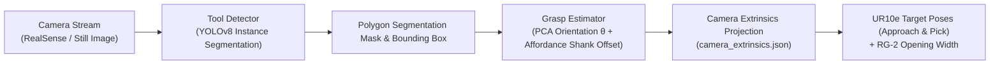

# Vision Recognition & Grasp Estimation Guide (Intel RealSense + UR10e)

This guide documents the vision subsystem located in `src/vision/` for real-time tool recognition, oriented grasp pose estimation, and coordinate projection for the **Universal Robots UR10e** and **OnRobot RG-2 Gripper**.

---

## 1. System Architecture



The vision pipeline is architected around a lean, single-engine **YOLO instance segmentation (`yolov8-seg`)** pipeline. It extracts pixel-accurate binary masks for oriented grasp calculation, supporting base COCO weights for lab proxies (e.g. `kitchen scissors`, `cutlery`) and custom fine-tuned Roboflow checkpoints for surgical instruments (`scalpel`, `scissors`, `hemostat`, `forceps`).

---

## 2. Input Sources Supported

1. **Still Image Photos (`--source data/vision/desk.jpg` or any image path)**:
   Pass any photo taken of your instruments or proxies on a desk or tray. The system immediately segments the objects, calculates yaw angle $\theta$, and displays the UR10e target pick coordinates.
2. **Intel RealSense D400 RGB-D Camera (`--source realsense`)**:
   Streams live color and depth over USB 3.0 via `pyrealsense2`.
3. **Automatic Fallback (`--source auto`)**:
   Attempts to initialize the physical Intel RealSense camera; if not connected, cleanly falls back to the sample dataset image `data/vision/desk.jpg`.

---

## 3. Quick Start: Running in the Lab

### Option A: Test with Sample Image (Recommended for Laptop / WSL2)

Run tests directly on the included sample image:

```bash
python3 test/test_vision_grasp.py --source data/vision/desk.jpg
```

*(Displays the detected bounding boxes, masks, grasp crosshairs, and UR10e coordinates immediately)*.

### Option B: Live Stream with Intel RealSense

Connect the Intel RealSense to USB 3.0 and run:

```bash
python3 test/test_vision_grasp.py --source realsense
```

### Option C: High-Speed Latency Benchmark

Profiles capture, detection, and grasping latencies:

```bash
python3 test/test_vision_grasp.py --source data/vision/desk.jpg --benchmark --runs 50
```

---

## 4. Interactive Controls & GUI Display

When the live window opens (`cv2.imshow`), you will see:

* **Green / Colored Bounding Box**: Target classification and confidence score.
* **Translucent Mask**: Tool segmentation overlay (35% alpha blend).
* **Cyan / Yellow Line**: Tool's major longitudinal axis (measured via PCA).
* **Red Crosshair**: The exact **shank grasp target point** (offset away from sharp blades and tips).
* **Top-Left HUD**:
  * Active camera backend and loaded model checkpoint.
  * Real-time FPS and latency.
  * Calculated **UR10e Target Cartesian Pose** $[X, Y, Z, Rx, Ry, Rz]$.
  * Recommended **RG-2 Gripper Opening Width** (mm).

### Keyboard Shortcuts in GUI:

* `q` or `ESC`: Quit the live view.
* `s`: Save a high-resolution annotated snapshot image to disk (`vision_snapshot_<timestamp>.jpg`).

---

## 5. Detector Architecture & Model Storage

In accordance with repository guidelines (`AGENTS.md` Rule 3), all model weights are stored in:
`src/vision/models/`

The detector automatically resolves checkpoints relative to `src/vision/models/`, keeping the repository root clean of `.pt` binary weights.

### Dependencies

```bash
pip install ultralytics
```

### Switching Checkpoints via `--model`

You can seamlessly switch between models using the `--model` flag:

1. **Everyday Lab Demonstration Model (COCO)**:

   ```bash
   python3 test/test_vision_grasp.py --source data/vision/desk.jpg --model yolov8n-seg.pt
   ```

   *Recognizes common lab objects (scissors, cutlery, proxies).*
2. **Fine-Tuned Surgical Model (Roboflow / Custom Checkpoint)**:
   Place your downloaded surgical `.pt` or `.onnx` weights into `src/vision/models/` (e.g. `surgical_tools.pt`), and run:

   ```bash
   python3 test/test_vision_grasp.py --source tray.jpg --model surgical_tools.pt
   ```

   *Recognizes actual surgical instruments: `scalpel`, `scissors`, `hemostat`, `forceps`.*

---

## 6. How Grasp Poses are Calculated

### 1. Affordance Shank Target (Avoiding Blades/Tips)

Rather than blindly grasping the center-of-mass (which may pinch blade shears or sharp tips), `GraspEstimator` measures the tool's major axis and samples the grip at the solid shank/neck:

* **Scissors, Hemostats, Clamps**: $35\%$ from working tip $\rightarrow$ targets the box-lock pivot screw and solid shank, leaving the finger rings $100\%$ open for handover.
* **Forceps, Pickups, Tweezers**: $50\%$ (mid-body) $\rightarrow$ targets the textured spring-grip pads.
* **Scalpels, Knives**: $30\%$ from blade tip $\rightarrow$ targets the forward neck behind the blade mount.
* **Pens, Slender Cylinders**: $45\%$ from tip $\rightarrow$ targets the central barrel.

### 2. Robot Coordinate Transformation (6-DOF Hand-Eye Kinematics)

The estimator loads `src/actuators/camera_extrinsics.json` with the full 6-DOF Hand-Eye transformation matrix ($^{tcp}T_{cam}$):

* **Eye-in-Hand Rigid Kinematics**:
  The camera is rigidly mounted to the robot tool flange/TCP. For any 3D point $\mathbf{p}_{cam} = [X_{cam}, Y_{cam}, Z_{cam}]^T$ measured by the camera:

  $$
  \mathbf{p}_{tcp} = R_{tcp}^{cam} \cdot \mathbf{p}_{cam} + \mathbf{t}_{tcp}^{cam}
  $$

  $$
  \mathbf{p}_{base} = R_{base}^{tcp} \cdot \mathbf{p}_{tcp} + \mathbf{t}_{base}^{tcp}
  $$

  Where $\mathbf{t}_{tcp}^{cam} = [39.38, 23.22, 0.0]\text{ mm}$ and $R_{tcp}^{cam}$ is the rigid rotation between tool center point and camera optical frame.
* **Rotation & Height Invariance**:
  Because coordinate projection operates in full 3D forward kinematics, target coordinate projection is completely invariant to arbitrary wrist rotations (e.g. Joint 5 flipped by $180^\circ$) and scan heights.
* **Guarded Plunge to Table Contact Height**:
  The approach pose approaches at the tray scan standoff height, while the pick pose descends to table contact:

  $$
  Z_{pick} = 0.02561\text{ m}
  $$
* Aligns wrist 3 / Joint 6 with the measured in-plane yaw angle $\theta$ normal to table floor $[0, 0, -1]$.

---

## 7. Automated Testing

Run the automated integration test suite:

```bash
python3 test/test_vision_grasp.py --test
```

Verifies image frame acquisition, contour segmentation, PCA major-axis calculation, UR10e target pose bounds, and RG-2 gripper millimeter clamping widths.

---

## 8. Exposure, Gain & USB Bandwidth Architecture

### 1. Deterministic Manual Exposure & Gain (Standard Robotic Mode)
To eliminate latency jitter, auto-exposure hunting, and brightness fluctuations caused by reflective stainless steel instruments or fiducial targets, the camera locks to deterministic manual mode by default:
* **Framerate**: `15 FPS` (doubles the maximum allowable shutter window while halving USB bandwidth)
* **Exposure**: `66000` μs (66ms shutter duration, capturing 2× more physical photons than 30 FPS)
* **Gain**: `32` (clean analog amplification without digital noise)
* **Warmup**: `2 frames` (~0.13s instantaneous buffer flush)

You can customize these via CLI flags if needed:
```bash
python3 test/test_vision_grasp.py --source realsense --fps 15 --exposure 66000 --gain 32
```

### 2. USB 2.0 vs USB 3.0 Bandwidth Optimization
* **USB 3.0+**: Stream operates with raw, uncompressed `bgr8` + `z16` depth.
* **USB 2.0 / USB 2.1 (WSL2 / Raspberry Pi 4)**: The driver automatically leverages hardware `mjpeg` compression to deliver high-resolution color frames without bus saturation.

