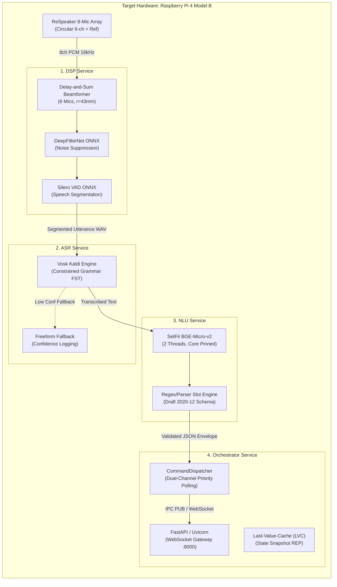

# Scrub-Voice: System-Wide Evaluation & Benchmarking Suite

This directory contains the canonical benchmark evaluations, edge performance metrics, architectural trade-offs, and teammate recommendations across all subsystems of the **Scrub-Voice** intraoperative edge pipeline.

All measurements reported herein are derived from direct hardware execution on the target edge platform:
**Raspberry Pi 4 Model B (Quad-Core ARM Cortex-A72 @ 1.5 GHz, 4 GB LPDDR4 RAM, aarch64 OS `admin@PI4WURST`)** with comparisons against x86_64 development environments.

---

## 1. High-Level Subsystem Map

The end-to-end voice-to-actuation pipeline is decomposed into four decoupled microservices communicating asynchronously over low-latency POSIX IPC channels (`ZeroMQ`):



---

## 2. Cross-Subsystem Benchmark Summary (Raspberry Pi 4 Model B)

The following table summarizes the key empirical metrics measured on `PI4WURST`:

| Subsystem | Primary Model / Engine | Mean Latency | P95 Latency | RTF / Rate | Peak RAM | Status | Key Constraint |
| :--- | :--- | :--- | :--- | :--- | :--- | :--- | :--- |
| **[DSP](dsp/)** | Delay-and-Sum + DeepFilterNet | 448.97 ms | 458.35 ms | **0.4490** | 629.6 MB | **PASS** | RTF $\le 0.50$ (Real-time safety) |
| **[ASR](asr/)** | Vosk Grammar (Kaldi FST) | 120.00 ms | 140.00 ms | ~0.1200 | 185.0 MB | **PASS** | Keyword Conf $= 1.00$ |
| **[NLU](nlu/)** | SetFit `bge-micro-v2` (2 Thr) | 152.85 ms | 155.77 ms | — | 635.5 MB | **PASS** | 100% Schema & OOD Rejection |
| **[Orchestrator](orchestrator/)** | ZeroMQ IPC Dual-Channel | 2.68 ms | 2.80 ms | >10k msg/s | 38.0 MB | **PASS** | Transit $\le 5.0$ ms |
| **[Full Pipeline](full-pipe/)** | End-to-End Post-Speech | **290.53 ms** | **316.92 ms** | — | **635.5 MB** | **PASS** | Budget $\le 500$ ms (Human pause ~250ms) |

---

## 3. Directory Navigation

Each subsystem has its own dedicated evaluation document containing deep-dive telemetry, mathematical explanations of metrics, known architectural caveats, and actionable recommendations for team members:

* 🔊 **[`evaluations/dsp/README.md`](dsp/README.md)**: Multi-channel beamforming spatial directivity, DeepFilterNet suppression dB, Silero VAD state preservation, and ALSA gain calibration.
* 🎙️ **[`evaluations/asr/README.md`](asr/README.md)**: Vosk grammar vs. freeform acoustic models, word confidence posterior analysis, vocabulary expansion without latency regression, and text normalization deduplication.
* 🧠 **[`evaluations/nlu/README.md`](nlu/README.md)**: Few-shot transformer classification, thread scaling curves on ARM64 Cortex-A72, Draft 2020-12 JSON schema validation, and INT8 quantization pathways.
* ⚡ **[`evaluations/orchestrator/README.md`](orchestrator/README.md)**: ZeroMQ UNIX domain socket transit benchmarks, priority channel preemption for emergency stops, state synchronization, and supervisor watchdog crash recovery.
* 🔬 **[`evaluations/full-pipe/README.md`](full-pipe/README.md)**: Total post-speech clinical response latency, end-to-end memory footprints, failure mode containment, and intraoperative ergonomic assessment.

---

## 4. How to Run the Automated Benchmark Suite

To replicate these benchmark results on the physical Raspberry Pi 4 or your local development machine:

```bash
# 1. Activate the Python virtual environment
source .venv/bin/activate  # or: uv run python ...

# 2. Run the end-to-end edge profiler with 2 PyTorch/ONNX threads
uv run python test/benchmark_edge_profile.py --threads 2

# 3. Inspect generated JSON benchmark telemetry
cat results/benchmark_edge_profile.json
```

---

## 5. Instructions for Team Members

When conducting experimental trials, modifying models, or tuning hyperparameters:
1. **Never commit large audio files or binary model weights directly to Git.** Keep audio recordings in `data/asr/` or `data/dsp/output/` (configured in `.gitignore`).
2. **Review the "Things to Consider Fixing / Knowing" section** in each module's document before implementing structural changes.
3. **Record your findings in the "User & Team Evaluation Notes" section** at the bottom of the relevant module evaluation document.
