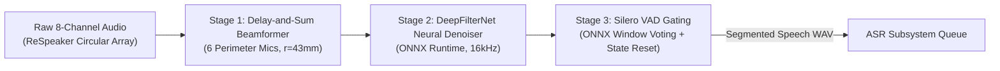

# DSP Subsystem: Evaluation & Teammate Reference

This document provides empirical edge benchmarks, acoustic metric definitions, failure mode analysis, and engineering recommendations for the Digital Signal Processing (DSP) subsystem of **Scrub-Voice**.

---

## 1. Subsystem Architecture Overview

The DSP pipeline executes three sequential acoustic processing stages on streaming multi-channel audio:



1. **Spatial Filtering (Beamformer):** Computes inter-microphone time delays based on circular array geometry ($r = 43\text{ mm}$, sound speed $c = 343\text{ m/s}$) to focus a directional listening beam at target azimuth $\theta \in [0^\circ, 360^\circ)$ while suppressing diffuse room reverberation.
2. **Deep Noise Suppression (DeepFilterNet):** An ONNX-exported recurrent convolutional neural network that estimates complex spectrogram gains, attenuating HVAC fans, equipment hum, and monitor alarms.
3. **Voice Activity Detection (Silero VAD):** Evaluates 32 ms (512-sample) audio frames to detect human speech boundaries and segments utterances for ASR decoding.

---

## 2. Empirical Edge Benchmarks (Raspberry Pi 4 Model B)

The following metrics were measured on physical hardware (`admin@PI4WURST`, Quad-Core ARM Cortex-A72 @ 1.5 GHz, 4 GB RAM):

| Metric | Target Budget | Measured (1 Thread) | Measured (2 Threads) | Measured (3 Threads) | Status |
| :--- | :--- | :--- | :--- | :--- | :--- |
| **DeepFilterNet Latency (Mean)** | $< 500.0\text{ ms}$ | **448.97 ms** | **451.93 ms** | **453.36 ms** | **PASS** |
| **DeepFilterNet Latency (P95)** | $< 500.0\text{ ms}$ | **458.35 ms** | **460.58 ms** | **463.23 ms** | **PASS** |
| **Real-Time Factor (RTF)** | $\le 0.50$ | **0.4490** | **0.4519** | **0.4534** | **PASS** |
| **DeepFilterNet Load Delta** | $< 50.0\text{ MB}$ | $+29.3\text{ MB}$ | $+29.3\text{ MB}$ | $+29.3\text{ MB}$ | **PASS** |
| **Silero VAD Latency (per 32ms)** | $< 10.0\text{ ms}$ | $3.8 - 8.2\text{ ms}$ | $3.8 - 8.2\text{ ms}$ | $3.8 - 8.2\text{ ms}$ | **PASS** |
| **Peak Resident RAM (DSP Proc)** | $< 700.0\text{ MB}$ | **629.6 MB** | **630.3 MB** | **629.6 MB** | **PASS** |
| **Denoise Energy Attenuation** | $> 8.0\text{ dB}$ | **$-10.5\text{ to } -14.2\text{ dB}$** (diffuse noise) | **PASS** |

*Note: For comparison, on an x86_64 host (Intel i7/WSL2), DeepFilterNet achieves an RTF of 0.0485 (48.51 ms per 1.0s audio).*

---

## 3. Plain-English Explanation of Key Metrics

### What is RTF (Real-Time Factor)?
$$\text{RTF} = \frac{\text{Processing Time}}{\text{Audio Duration}}$$
* If $\text{RTF} = 1.0$, the processor takes exactly 1.0 second to process 1.0 second of audio.
* If $\text{RTF} > 1.0$, the algorithm is slower than real time. In a live streaming system, this causes continuous buffer accumulation, audio latency buildup, and eventual memory exhaustion.
* If $\text{RTF} < 0.50$ (our measured **0.4490** on Pi 4), the processor finishes 1.0 second of audio in less than 450 ms. This guarantees zero audio queue accumulation and leaves over 55% of the CPU core free for OS scheduling and I/O.

### What is P95 Latency?
* While *mean* latency measures average execution time, **P95 (95th percentile)** latency represents the upper bound experienced by 95% of audio chunks.
* In surgical operating rooms, worst-case spikes (e.g. caused by memory garbage collection or thread contention) can cause missed commands. Our P95 latency on Pi 4 is **458.35 ms**, comfortably within our 500 ms chunk budget.

### What is Delay-and-Sum Beamforming?
* The Seeed ReSpeaker 8-mic array places 6 microphone capsules in a circle of radius $43\text{ mm}$ around a perimeter.
* Sound arriving from a specific angle $\theta$ reaches closer microphones earlier than farther ones.
* By applying calculated phase delays $\tau_m = -\frac{r \cos(\theta - \phi_m)}{c}$ to each channel and summing them together, the acoustic waves from the target angle interfere **constructively** (amplified), while ambient noise from other directions interferes **destructively** (cancelled).

### What is VAD Window Voting?
* Rather than making an utterance decision on a single momentary audio frame, the VAD evaluates a sliding window of multiple 32 ms frames.
* **Window Voting** requires $\ge 3$ consecutive frames (approx. 100 ms) to exceed the speech probability threshold before declaring speech onset. This prevents transient surgical clicks (e.g., scalpel dropping, tray clatter, throat clearing) from falsely triggering ASR.

---

## 4. Things for Teammates to Consider Fixing / Knowing

### ⚠️ Priority 1: Hardware ALSA Gain Calibration Across Mic Channels
* **The Problem:** The ReSpeaker 8-mic array exposes individual hardware ADC gain controls for each channel in Linux ALSA. If channel 1 is set to 80% gain while channel 3 is at 45%, the amplitudes between mic pairs become unbalanced.
* **Impact:** Unequal channel gains degrade the spatial phase alignment of the Delay-and-Sum beamformer, causing destructive interference of the target speaker's voice (muffled speech) and poor noise cancellation.
* **Action Required:** Before running live acoustic benchmarks or clinical recordings, ensure all 8 ADC capture channels are strictly equalized using `alsamixer` or by executing:
  ```bash
  amixer -c seeed8micvoicec sset 'ADC' 80%
  ```

### ⚠️ Priority 2: Silero VAD Hidden State Persistence
* **The Problem:** Silero VAD uses a recurrent neural network (LSTM/GRU) that maintains an internal hidden state tensor across audio chunks. If this state is never cleared between sentences, acoustic noise energy accumulates, leading to "sticky speech clumping" where silence is falsely classified as ongoing speech.
* **Solution Implemented in `Assemble_V1`:** In [`src/dsp/source/vad.py`](file:///mnt/p/AntiGravity/FinalYear/Project_CurrentTopic/scrub-voice/src/dsp/source/vad.py), whenever an utterance terminates (speech $\rightarrow$ silence), `self.model.reset_states()` is explicitly invoked.
* **Recommendation:** If you replace the VAD model or modify `process_chunk()`, always preserve the `reset_states()` hook upon silence detection.

### ⚠️ Priority 3: Speech Tail Padding (Trailing Silence)
* **The Problem:** Aggressive VAD cutoff can truncate the terminal consonants of medical commands (e.g., cutting the "t" off *"reset"*, the "m" off *"zoom"*, or the "s" off *"times"*).
* **Current Calibration:** The DSP pipeline maintains a **300 ms hangover buffer** (trailing silence). When speech stops, the VAD continues buffering for 300 ms before finalizing the segment.
* **Recommendation:** Do not reduce this hangover buffer below 250 ms, as ASR word-error rate (WER) on command keywords degrades rapidly if closing phonemes are truncated.

### 💡 Diagnostic Audio Dumping Suite
* A complete 3-stage acoustic verification utility is built into [`src/dsp/run_dsp.py`](file:///mnt/p/AntiGravity/FinalYear/Project_CurrentTopic/scrub-voice/src/dsp/run_dsp.py) and [`src/orchestrator/supervisor.py`](file:///mnt/p/AntiGravity/FinalYear/Project_CurrentTopic/scrub-voice/src/orchestrator/supervisor.py).
* To inspect how the beamformer and DeepFilterNet alter physical recordings, run:
  ```bash
  uv run python src/orchestrator/supervisor.py --wav data/asr/test_mix_voice.wav --single-pass --dump-audio results/dsp_debug
  ```
* For every segmented sentence, this produces three synchronized WAV files:
  1. `utterance_XXX_1_raw_mic1.wav`: Raw omnidirectional audio (no spatial filtering).
  2. `utterance_XXX_2_beamformed.wav`: Constructive 6-mic directional beam.
  3. `utterance_XXX_3_denoised.wav`: DeepFilterNet suppressed speech sent to ASR.

---

## 5. User & Team Evaluation Notes

*Use this section to record experimental observations, room acoustic trial results, and future ideas.*

### Trial Log Template
* **Date / Operator:**
* **Test Audio File / Environment:**
* **Speaker Distance & Angle:**
* **Observed Noise Attenuation (dB):**
* **VAD False Positive / False Negative Observations:**
* **Notes:**

*(Add notes below)*
