# Full Pipeline: System-Wide Changes & Toolchain Unification

This document logs all system-wide architectural modifications, dependency consolidations, and integration patterns established in `Assemble_V1`.

---

## 1. System Integration Overview

Before `Assemble_V1`, the repository consisted of decoupled scripts that could not communicate or execute concurrently. `Assemble_V1` unified them into an asynchronous, multi-process edge pipeline orchestrated via ZeroMQ POSIX IPC and monitored by a supervisor daemon.

```mermaid
flowchart LR
    A["src/dsp/run_dsp.py<br/>(DSP Daemon)"] -->|ipc:///tmp/scrub_audio.ipc| B["src/asr/scripts/run_asr.py<br/>(ASR Daemon)"]
    B -->|ipc:///tmp/scrub_asr.ipc| C["src/nlu/run_nlu.py<br/>(NLU Daemon)"]
    C -->|ipc:///tmp/scrub_nlu.ipc<br/>ipc:///tmp/scrub_nlu_priority.ipc| D["src/orchestrator/run_monitor_service.py<br/>(Dispatcher & Web Monitor)"]
    D -->|WebSocket :8000/ws| E["Intraoperative Browser UI"]
```

---

## 2. System-Level Modifications

### A. Modern Declarative Packaging (`pyproject.toml` & `uv.lock`)
* **Old State:** Loose `requirements.txt` with conflicting dependencies (PyPI vs. PyTorch CPU indices for `requests` and `torch`).
* **New State:** Pinned Python to `3.13.5` with reproducible resolution via `uv.lock`. Configured `link-mode = "copy"` in `uv` to resolve WSL cross-filesystem hardlink issues across Windows NTFS mounts.

### B. Decoupled Multi-Process Architecture
* **Old State:** Research scripts tested interactively or sequentially.
* **New State:** Four decoupled processes running in isolated memory spaces under [`src/orchestrator/supervisor.py`](file:///mnt/p/AntiGravity/FinalYear/Project_CurrentTopic/scrub-voice/src/orchestrator/supervisor.py). Eliminates GIL contention, guarantees independent garbage collection, and confines failures to individual worker processes.

### C. Standardized Inter-Process Communication (IPC)
* Replaced ad-hoc networking with in-memory POSIX UNIX domain sockets (`ZeroMQ IPC`).
* Standardized socket addresses:
  * `ipc:///tmp/scrub_audio.ipc`: DSP $\rightarrow$ ASR (PCM frames + control signals)
  * `ipc:///tmp/scrub_asr.ipc`: ASR $\rightarrow$ NLU (Transcripts + token confidences)
  * `ipc:///tmp/scrub_nlu.ipc`: NLU $\rightarrow$ Dispatcher (Normal validated command envelopes)
  * `ipc:///tmp/scrub_nlu_priority.ipc`: NLU $\rightarrow$ Dispatcher (Emergency fast-path envelopes)
  * `ipc:///tmp/scrub_bus.ipc`: Dispatcher $\rightarrow$ External consumers (ZeroMQ PUB)
  * `ipc:///tmp/scrub_snapshot.ipc`: State sync server (ZeroMQ REP for LVC)

### D. Automated Edge Profiling Suite
* Created [`test/benchmark_edge_profile.py`](file:///mnt/p/AntiGravity/FinalYear/Project_CurrentTopic/scrub-voice/test/benchmark_edge_profile.py) to profile real hardware latency, RTF, and RSS memory directly on Raspberry Pi 4 (ARM64) and emit machine-readable telemetry to `results/benchmark_edge_profile.json`.
