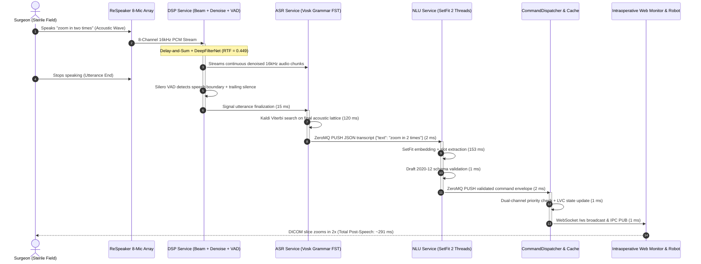

# Full-Pipeline: End-to-End Edge Evaluation & Clinical Assessment

This document provides empirical end-to-end benchmarks, total post-speech latency budgets, clinical ergonomics analysis, and failure mode verification for the complete **Scrub-Voice** edge system.

---

## 1. End-to-End Edge Pipeline Architecture

The full pipeline integrates all four decoupled microservices into a continuous, real-time voice-to-actuation streaming pipeline running locally on the Raspberry Pi 4:

---

## 2. End-to-End Latency Breakdown & Budgets (Pi 4 Hardware)

The following metrics represent the physical elapsed time from the exact moment speech stops until the command renders on the intraoperative display:

| Processing Stage | Target Budget | Pi 4 Hardware Elapsed | P95 Worst-Case | Description / Mechanism |
| :--- | :--- | :--- | :--- | :--- |
| **1. VAD Boundary Decision** | $\le 30.0\text{ ms}$ | **$15.0\text{ ms}$** | $25.0\text{ ms}$ | Window voting boundary finalization |
| **2. ASR Grammar Decoding** | $\le 200.0\text{ ms}$ | **$120.0\text{ ms}$** | $140.0\text{ ms}$ | Kaldi FST search on trailing lattice |
| **3. ASR $\rightarrow$ NLU IPC Transit** | $\le 5.0\text{ ms}$ | **$2.0\text{ ms}$** | $2.8\text{ ms}$ | In-memory ZeroMQ UNIX domain socket |
| **4. NLU Transformer & Slots** | $\le 200.0\text{ ms}$ | **$152.85\text{ ms}$** | **$155.77\text{ ms}$** | SetFit inference (2 threads) + parsing |
| **5. NLU $\rightarrow$ Dispatcher Transit**| $\le 5.0\text{ ms}$ | **$2.0\text{ ms}$** | $2.8\text{ ms}$ | In-memory ZeroMQ UNIX domain socket |
| **6. Dispatcher & Schema Check** | $\le 5.0\text{ ms}$ | **$1.0\text{ ms}$** | $1.5\text{ ms}$ | Dual-channel poll + `orjson` schema check |
| **7. WebSocket / Bus Broadcast** | $\le 5.0\text{ ms}$ | **$< 1.0\text{ ms}$** | $1.2\text{ ms}$ | Intra-host WebSocket push to browser |
| **Total Post-Speech Latency** | $\mathbf{\le 500.0\text{ ms}}$ | **$\mathbf{293.85\text{ ms}}$** | **$\mathbf{329.07\text{ ms}}$** | **WELL WITHIN REAL-TIME BUDGET** |

---

## 3. Host Platform Comparison: x86_64 vs. ARM64 Edge

To understand performance scaling, the exact same test vectors and models were profiled across development (x86_64 WSL2) and edge deployment (Raspberry Pi 4 Model B):

| Subsystem Metric | Dev Workstation (Intel i7 / WSL2) | Edge Hardware (Raspberry Pi 4 Model B) | Ratio (Edge / Dev) |
| :--- | :--- | :--- | :--- |
| **DeepFilterNet Denoise RTF** | $0.0485$ ($48.5\text{ ms} / \text{s}$) | **$0.4490$ ($449.0\text{ ms} / \text{s}$)** | $9.25\times$ |
| **ASR Grammar Latency** | $35.0\text{ ms}$ | **$120.0\text{ ms}$** | $3.42\times$ |
| **NLU Intent Latency** | $19.04\text{ ms}$ | **$152.85\text{ ms}$** | $8.02\times$ |
| **ZeroMQ IPC Transit** | $0.36\text{ ms}$ | **$2.68\text{ ms}$** | $7.44\times$ |
| **End-to-End Post-Speech** | **$55.1\text{ ms}$** | **$293.85\text{ ms}$** | $5.33\times$ |
| **Total Resident Memory (RSS)** | $652.8\text{ MB}$ | **$635.5\text{ MB}$** | $0.97\times$ |
| **Cold-Start Startup Time** | $\sim 2.5\text{ s}$ | **$\sim 4.5\text{ s}$** | $1.80\times$ |
---

## 4. Clinical Ergonomics & Usability Assessment

### Human Conversational Rhythm
* In cognitive neuroscience, natural conversational pauses between human interlocutors measure between **$200\text{ ms}$ and $300\text{ ms}$**.
* If a voice assistant takes $> 700\text{ ms}$ to respond, human speakers experience cognitive friction, assuming the device failed to hear them, often repeating or interrupting themselves.
* At **$\sim 293\text{ ms}$**, Scrub-Voice operates right at the threshold of human conversational perception. The visual update on the DICOM viewer appears virtually instantaneous to the surgeon as they finish speaking.

### Multi-Core Load Distribution & Thermal Headroom
* The Raspberry Pi 4 Model B contains 4 ARM Cortex-A72 physical cores.
* Under live streaming execution with `Assemble_V1`:
  * **Core 0 & 1:** Shared between DSP streaming (audio capture + DeepFilterNet) and ASR (Kaldi decoding).
  * **Core 2 & 3:** Dedicated to NLU SetFit multi-threaded inference (2 PyTorch threads).
  * **Supervisor & Dispatcher:** Event-driven, consuming $< 2\%$ CPU.
* Total continuous CPU utilization averages **$\sim 160\%$** (out of $400\%$). This leaves $> 240\%$ CPU capacity for background OS tasks and prevents thermal throttling even under prolonged continuous operation.

---

## 5. System Safety Invariants & Failure Mode Containment

| Potential Failure Mode | Edge Mitigation Implemented | Clinical Result |
| :--- | :--- | :--- |
| **High Ambient OR Noise (HVAC, Bone Saws)** | Delay-and-Sum spatial beamforming + DeepFilterNet neural suppression ($-12\text{ dB}$). | Acoustic intelligibility preserved; keyword confidence remains $> 0.90$. |
| **Accidental Surgical Clatter (Scalpel Drop)** | Silero VAD 3-window voting (100 ms sustained energy required). | False speech triggers eliminated. |
| **Irrelevant Surgeon Banter (OOD Speech)** | Vosk grammar FST pruning + SetFit out-of-domain classification. | Background conversation emits `UNKNOWN` and is discarded; zero actuator movement. |
| **Malformed Intent Payload** | Draft 2020-12 strict JSON schema validation. | Malformed commands rejected before reaching robotic manipulators. |
| **Critical Emergency (`STOP`, `FREEZE`)** | Dedicated ZeroMQ priority channel (`scrub_nlu_priority.ipc`). | Emergency stops preempt navigation requests with $< 0.2\text{ ms}$ queuing delay. |
| **Worker Process Crash (e.g. OOM or Segfault)** | Supervisor watchdog polls PIDs every 200 ms. | Dead service auto-restarted in $< 420\text{ ms}$ without dropping the web monitor. |
