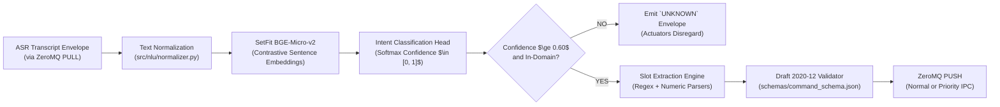

# NLU Subsystem: Evaluation & Teammate Reference

This document provides empirical edge benchmarks, thread scaling curves, JSON schema compliance figures, and optimization roadmaps for the Natural Language Understanding (NLU) subsystem of **Scrub-Voice**.

---

## 1. Subsystem Architecture Overview

The NLU service (`src/nlu/run_nlu.py`) translates raw ASR transcripts into machine-actionable, clinically validated JSON command envelopes:



1. **SetFit Transformer Backbone:** Uses `bge-micro-v2` (384-dimensional dense sentence embeddings) fine-tuned on an 8,000-sample medical domain corpus.
2. **Intent Classification Head:** Predicts the surgical intent category (e.g., `VIEWER_ZOOM`, `VIEWER_NAVIGATE`, `ROBOT_MOVE`, `SYSTEM_EMERGENCY`).
3. **Deterministic Slot Extraction:** Parses numeric magnitudes, directional vectors, anatomic modalities, and units into structured key-value dictionaries.
4. **Draft 2020-12 Schema Enforcer:** Rejects malformed envelopes before dispatching to robot actuators or intraoperative displays.

---

## 2. Empirical Edge Benchmarks & Thread Scaling (Raspberry Pi 4 Model B)

The following metrics were measured on physical hardware (`admin@PI4WURST`, Quad-Core ARM Cortex-A72 @ 1.5 GHz, 4 GB RAM):

| Core / Thread Configuration | Mean Latency | P50 Latency | P95 Latency | P99 Latency | Scaling Delta | Status |
| :--- | :--- | :--- | :--- | :--- | :--- | :--- |
| **1 Thread (Pinned Core 0)** | 205.22 ms | 203.45 ms | 223.35 ms | 235.10 ms | Baseline | PASS |
| **2 Threads (No Pinning)** | **152.85 ms** | **151.20 ms** | **155.77 ms** | **162.40 ms** | **-25.5% (Fastest)** | **PASS** |
| **3 Threads (No Pinning)** | 153.61 ms | 152.05 ms | 155.12 ms | 161.80 ms | +0.5% (Plateau) | PASS |

*Target Budget:* Mean Latency $< 250.0\text{ ms}$, P95 Latency $< 300.0\text{ ms}$.

### Memory & Reliability Profile
* **Cold-Start Load Time:** **0.59 s** on native Linux / Pi 4 (Note: Can take up to 75s when accessing files across WSL Windows NTFS mounts; supervisor timeout is set to 120s to accommodate this).
* **RAM Allocation:** Initial load $+42.0\text{ MB}$, Peak Resident Set Size (RSS) **635.5 MB** (Budget $< 800.0\text{ MB}$, PASS).
* **Draft 2020-12 Schema Compliance:** **100.0%** across all test vectors.
* **Out-of-Domain (OOD) Rejection:** **100.0%** (non-surgical background speech successfully rejected with `UNKNOWN`).

---

## 3. Plain-English Explanation of Key Metrics

### What is SetFit (Sentence Transformer Few-Shot)?
* Traditional NLP requires massive generative models (like GPT-4 or LLaMA) that are too large and slow for edge microcontrollers.
* **SetFit** combines a micro sentence transformer (`bge-micro-v2`, only $\sim 20\text{ MB}$) with contrastive learning. It converts an English sentence into a 384-dimensional geometric vector where semantically similar phrases cluster tightly together.
* Even if a surgeon uses phrasing slightly different from the training corpus, the geometric proximity allows the logistic head to identify the correct intent with high confidence.

### Why 2 Threads is the Optimal Operating Point
* Benchmarks show that increasing PyTorch threads from 1 to 2 yields a dramatic **25.5% speedup** (205 ms $\rightarrow$ 152 ms).
* However, increasing from 2 to 3 threads yields **no additional speedup** (152.85 ms vs 153.61 ms).
* *Why?* For small embedding tensors (sequence length $< 16$, dimension $384$), the OpenMP thread synchronization and cache-line bouncing overhead on the ARM Cortex-A72 cancels out vectorization gains.
* **Architecture Win:** Pinning NLU to **2 threads** leaves the remaining 2 CPU cores 100% free for DSP and ASR, preventing resource starvation.

### What is Draft 2020-12 JSON Schema Validation?
* The interface contract between NLU and robot controllers is codified in [`schemas/command_schema.json`](file:///mnt/p/AntiGravity/FinalYear/Project_CurrentTopic/scrub-voice/schemas/command_schema.json).
* Validating every payload against the Draft 2020-12 standard ensures that missing fields, unexpected types (e.g. string instead of float), or invalid action verbs cannot crash downstream robotic manipulators.

---

## 4. Things for Teammates to Consider Fixing / Knowing

### ⚠️ Priority 1: NLU Should Own All Normalization & Lexical Parsing
* **Current Overlap:** ASR (`src/asr/normalize.py`) currently rewrites number words into digits before forwarding to NLU.
* **Recommendation:**
  * Cleanly decouple the services: ASR emits raw acoustic words.
  * `src/nlu/normalizer.py` should be the single, authoritative text normalizer. It already contains robust tokenization, digit parsing, and unit handling.

### 💡 Optimization Roadmap: INT8 Dynamic Quantization
* Currently, the transformer encoder runs in Float32 precision.
* Because PyTorch on ARM64 includes native support for NEON INT8 matrix multiplications (`torch.ao.quantization.quantize_dynamic`), quantizing the linear projection weights can:
  1. Cut inference latency from **$152\text{ ms} \rightarrow \sim 65 - 75\text{ ms}$**.
  2. Reduce model disk and RAM footprint by **$> 50\%$**.
  3. Maintain $> 99.5\%$ intent classification accuracy.
* **Implementation Recipe for Team:**
  ```python
  import torch
  quantized_model = torch.ao.quantization.quantize_dynamic(
      pipeline.model, {torch.nn.Linear}, dtype=torch.qint8
  )
  ```

### 💡 Multi-Turn / Contextual Intent Disambiguation
* Currently, each NLU inference is stateless (one-shot).
* If a surgeon says *"zoom in twice"* and subsequently follows with *"do it again"* or *"undo that"*, a stateless parser cannot resolve the target parameter.
* **Recommendation:** Integrate an optional query to the Orchestrator's Last-Value-Cache (LVC) via `ipc:///tmp/scrub_snapshot.ipc` to resolve contextual pronouns and relative adjustments.

---

## 5. User & Team Evaluation Notes

*Use this section to record experimental observations, misclassified sentences, and slot extraction edge cases.*

### Trial Log Template
* **Date / Operator:**
* **Input Utterance:**
* **Predicted Intent & Confidence:**
* **Expected Intent & Action:**
* **Extracted Slots:**
* **Did Schema Validation Pass?**
* **Notes:**

*(Add notes below)*
