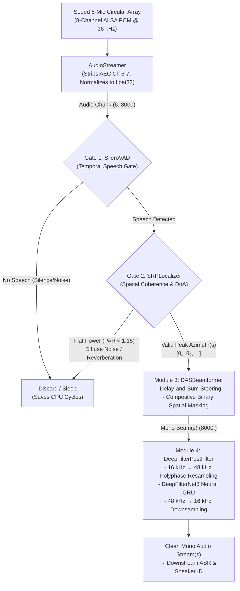

# Digital Signal Processing (DSP) Module

This module implements the edge acoustic front-end for `scrub-voice`. It is designed for multi-channel circular microphone arrays operating in noisy, reverberant clinical environments (such as operating rooms with surgical suction, ventilation, and patient monitors).

The pipeline ingests raw multi-channel audio from hardware, filters acoustic artifacts, identifies human speech activity, calculates sound source direction of arrival (DoA), isolates target speakers using spatial beamforming with **competitive binary spatial masking**, and restores speech clarity via neural post-filtering before passing single-channel audio to downstream Automatic Speech Recognition (ASR) and Natural Language Understanding (NLU).

---

## 1. Architecture & Pipeline Overview

The front-end is organized as a phased gating and processing pipeline to minimize computational load on edge hardware (e.g., Raspberry Pi 4):



---

## 2. Core Submodules

### 2.1. Audio Streamer (`source/audio_streamer.py`)

Handles low-latency, uninterrupted streaming from the microphone hardware via standard ALSA subprocesses.

* **Target Hardware:** Seeed ReSpeaker 6-Mic Circular Array for Raspberry Pi (via `plughw:seeed8micvoicec,0`).
* **Hardware Channel Mapping:**
  * Physical capture delivers 8 interleaved channels: channels `0` to `5` correspond to circular microphones 1–6; channels `6` and `7` carry hardware Acoustic Echo Cancellation (AEC) playback loopback data.
  * `AudioStreamer` strips channels 6 and 7, retaining only the 6 circular microphone sensors.
* **Buffer Management:**
  * Uses `arecord` with `--buffer-time=500000` (500 ms ALSA driver buffer) to prevent buffer underruns (XRUNs) under heavy Raspberry Pi CPU loads.
  * Chunks are emitted in configurable durations (default `0.5 s` = 8,000 samples at 16 kHz).
* **Data Contract:**
  * Output shape: `(6, 8000)` (`(num_mics, num_samples)`).
  * Data type: `float32`, normalized from 16-bit signed PCM to `[-1.0, 1.0]`.
* **Graceful Lifecycle Management:**
  * Supports Python context manager (`with AudioStreamer() as streamer:`).
  * Shutdown closes the stdout pipe and issues a `SIGINT` signal to `arecord`, allowing the ALSA kernel driver to close cleanly without driver lockups or device-busy deadlocks.

---

### 2.2. Voice Activity Detection — Gate 1 (`source/vad.py`)

Acts as the first computational gate, determining whether an incoming multi-channel audio buffer contains active human speech before activating downstream spatial algorithms.

* **Model:** Pretrained Silero VAD neural network (`snakers4/silero-vad`).
* **Multichannel Reduction:**
  * Averages acoustic energy across all active microphones (`np.mean(audio_chunk, axis=0)`) to yield a high-SNR composite reference signal.
* **Inference Details:**
  * Evaluates audio in non-overlapping sub-windows of 512 samples (~32 ms at 16 kHz).
  * If any sub-window exceeds `threshold` (default `0.5`), the chunk is flagged as speech-active (`is_speech_active() -> True`).
  * If no speech is present, downstream localization and beamforming are skipped entirely, saving edge processor cycles.

---

### 2.3. Sound Source Localizer — Gate 2 (`source/localizer.py`)

Calculates 2D azimuth Direction of Arrival (DoA) using Steered Response Power with Phase Transform (SRP-PHAT) and validates spatial coherence.

* **Array Geometry:**
  * Circular planar array with radius $r = 0.04625$ m (46.25 mm).
  * 6 microphones configured at angles: `[300°, 240°, 180°, 120°, 60°, 0°]`.
* **Precomputed Spatial Steering:**
  * Discrete azimuth grid with 1° resolution covering 360° (`[0°, 1°, ..., 359°]`).
  * Relative theoretical delay for azimuth $\theta$ and microphone $m$:
    $$\tau(\theta, m) = \frac{r}{c} \cos(\theta - \phi_m)$$
    where $c = 343.0\text{ m/s}$.
  * Precomputes full steering phase tensor of shape `(360, num_mics, num_freqs)`.
* **Frequency Band Selection:**
  * Evaluates Short-Time Fourier Transform (STFT) frames (frame size 512, hop size 256, Hann window).
  * Bounded to the human speech band (`100 Hz` to `3500 Hz`), filtering out high-frequency surgical tool hiss and electrical low-frequency hum.
* **Spatial Coherence Gating (Gate 2 Check):**
  * Computes steered power across all 360 directions and evaluates the Peak-to-Average Ratio:
    $$\text{PAR} = \frac{\max(P_{360})}{\text{mean}(P_{360}) + \epsilon}$$
  * If $\text{PAR} < \text{par\_threshold}$ (default `1.15`), the sound field lacks directional coherence (characteristic of diffuse room noise, air conditioning, or late reverberation). The gate closes and returns an empty angle list `[]`.
* **Multi-Speaker Peak Detection:**
  * Applies 30° circular padding to prevent detection dropouts at the $0^\circ / 360^\circ$ boundary.
  * Detects peaks using `scipy.signal.find_peaks` with minimum angular distance (15°), peak prominence (0.15), and minimum relative height (0.25).
  * Returns deduplicated list of speaker angles (e.g., `[60.0, 180.0]`) and the normalized spatial power curve.

---

### 2.4. Delay-and-Sum Beamformer with Binary Spatial Masking (`source/beamformer.py`)

Steers focused constructive acoustic beams toward target speakers and isolates competing sound sources using Time-Frequency spatial masking.

* **Steering & Reconstruction:**
  * Operates across the full frequency spectrum (0 Hz to Nyquist 8000 Hz, 257 bins for 512-point FFT).
  * Precomputed steering weights tensor with $\frac{1}{M}$ normalization:
    $$W_m(f, \theta) = \frac{1}{M} \exp\left(j 2 \pi f \cdot \frac{r}{c} \cos(\theta - \phi_m)\right)$$
  * Multi-target support: Steers multiple beams simultaneously across target angles using vectorized tensor operations.
* **Competitive Binary Spatial Masking (`binarymask` branch feature):**
  * When multiple speakers are present (e.g., Lead Surgeon at 60° and Scrub Nurse at 180°) and `apply_spatial_mask=True`:
    1. Computes instantaneous spectrogram power for each beam:
       $$P_k(f, t) = |Y_k(f, t)|^2, \quad k \in \{1, \dots, K\}$$
    2. Identifies the dominant winning beam at every time-frequency tile $(f, t)$:
       $$k^*(f, t) = \arg\max_{k} P_k(f, t)$$
    3. Synthesizes an ideal binary spatial mask for target $k$:
       $$M_k(f, t) = \begin{cases} 1 & \text{if } k = k^*(f, t) \\ 0 & \text{otherwise} \end{cases}$$
    4. Applies the mask to suppress cross-talk between simultaneous speakers.
* **Overlap-Add (OLA) Synthesis:**
  * Performs inverse STFT (`irfft`) with Hann window synthesis and energy normalization to reconstruct continuous time-domain signals without blocking artifacts.
* **Data Contract:**
  * Input: `audio_chunk` of shape `(6, N)`, `target_angles` (scalar `float` or `List[float]`).
  * Output: Single 1D array `(N,)` (if single angle) or `List[np.ndarray]` each of shape `(N,)` (if list of angles).

---

### 2.5. Neural Spectral Post-Filter (`source/postfilter.py`)

Module 4 cleans the beamformed mono output using DeepFilterNet3 to strip comb-filtering notches, spatial leakage, room reverberation tails, and diffuse stationary noise.

* **Architecture:**
  * Wraps DeepFilterNet3 (combining Equivalent Rectangular Bandwidth convolutional layers and recurrent GRU deep filtering).
* **Polyphase Resampling Pipeline:**
  * DeepFilterNet3 natively operates at 48 kHz, while the front-end capture runs at 16 kHz.
  * Uses `scipy.signal.resample_poly` with integer factors $3:1$ (up) and $1:3$ (down):
    $$\text{16 kHz Audio} \xrightarrow{\times 3} \text{48 kHz Audio} \xrightarrow{\text{DeepFilterNet3}} \text{Clean 48 kHz} \xrightarrow{\div 3} \text{Clean 16 kHz Audio}$$
  * Zero phase distortion and low latency compared to standard FFT resamplers.
* **Stateful Streaming:**
  * Maintains internal recurrent buffer state (`df_state`) across consecutive 0.5s chunks, ensuring smooth spectral envelope transitions across chunk boundaries without audible clicks.
* **Batch Multi-Stream Support:**
  * `enhance_multi(audio_streams: list[np.ndarray])` processes multiple isolated speaker streams sequentially.

---

## 3. Module File Structure

```text
src/dsp/
├── README.md                      # This documentation
├── __init__.py
├── denoise/                       # Standalone DeepFilterNet models & ONNX exports (excluded from this guide)
├── source/
│   ├── __init__.py
│   ├── audio_streamer.py          # ALSA arecord hardware capture & buffer stripping
│   ├── vad.py                     # Gate 1: Silero VAD speech activity detection
│   ├── localizer.py               # Gate 2: SRP-PHAT DoA localization & PAR gating
│   ├── beamformer.py              # Module 3: Delay-and-Sum beamformer with binary masking
│   └── postfilter.py              # Module 4: DeepFilterNet3 neural post-filter wrapper
└── test/
    ├── __init__.py
    ├── unittest_AudioStreamer.py      # Unit tests for hardware streaming buffer slicing
    ├── unittest_VAD.py                # Unit tests for Silero VAD gating & sensitivity
    ├── unittest_localizer_level1.py   # Unit tests for SRP-PHAT geometry & synthetic DoA
    ├── unittest_localizer_level2.py   # Boundary wrap-around & multi-speaker peak tests
    ├── unittest_beamformer.py         # Unit tests for DAS steering & binary mask isolation
    ├── unittest_postfilter.py         # Unit tests for DeepFilterNet3 polyphase I/O & streaming state
    ├── test_live_vad_localizer.py     # Live console visualizer for VAD and DoA tracking
    ├── test_beamformer_integration.py # Real-time multi-channel live beamforming runner
    └── test_postfilter_offline.py     # Offline post-filtering benchmark for saved recordings
```

---

## 4. Quick Start & Usage Examples

### 4.1. Processing a Multi-Channel Chunk (Synchronous Flow)

```python
import numpy as np
from src.dsp.source.vad import SileroVAD
from src.dsp.source.localizer import SRPLocalizer
from src.dsp.source.beamformer import DASBeamformer
from src.dsp.source.postfilter import DeepFilterPostFilter

# Initialize DSP pipeline components
vad = SileroVAD(sample_rate=16000, threshold=0.35)
localizer = SRPLocalizer(sample_rate=16000, radius=0.04625)
beamformer = DASBeamformer(sample_rate=16000, radius=0.04625)
postfilter = DeepFilterPostFilter(sample_rate=16000)

# Assume multi_channel_chunk has shape (6, 8000), float32 [-1.0, 1.0]
multi_channel_chunk = np.zeros((6, 8000), dtype=np.float32)

# Gate 1: Check voice activity
if vad.is_speech_active(multi_channel_chunk):
    # Gate 2: Localize speaker angles
    speaker_angles, power_profile = localizer.localize(multi_channel_chunk)
    
    if speaker_angles:
        print(f"Speakers detected at angles: {speaker_angles}")
        
        # Module 3: Steer beam(s) with competitive binary masking
        isolated_beams = beamformer.beamform(
            multi_channel_chunk, 
            target_angles=speaker_angles,
            apply_spatial_mask=True
        )
        
        # Module 4: Apply neural post-filtering
        if isinstance(isolated_beams, list):
            clean_streams = postfilter.enhance_multi(isolated_beams)
        else:
            clean_streams = [postfilter.enhance(isolated_beams)]
            
        # clean_streams contains clean 16 kHz mono audio ready for ASR
```

### 4.2. Running Live Hardware Stream on Raspberry Pi 4

To run the full end-to-end capture and beamforming pipeline on hardware:

```bash
# Verify ReSpeaker 6-mic device presence
arecord -l

# Run real-time streaming pipeline
python src/dsp/test/test_beamformer_integration.py
```

---

## 5. Verification & Unit Testing

All algorithms feature hardware-free unit tests utilizing synthetic far-field broadband acoustic sources to verify geometric steering equations, frequency phase alignments, and masking bounds.

Run the test suite using `pytest`:

```bash
# Run all unit tests for the DSP package
pytest src/dsp/test/unittest_*.py -v

# Run individual test suites
pytest src/dsp/test/unittest_VAD.py -v
pytest src/dsp/test/unittest_localizer_level1.py -v
pytest src/dsp/test/unittest_localizer_level2.py -v
pytest src/dsp/test/unittest_beamformer.py -v
pytest src/dsp/test/unittest_postfilter.py -v
```

